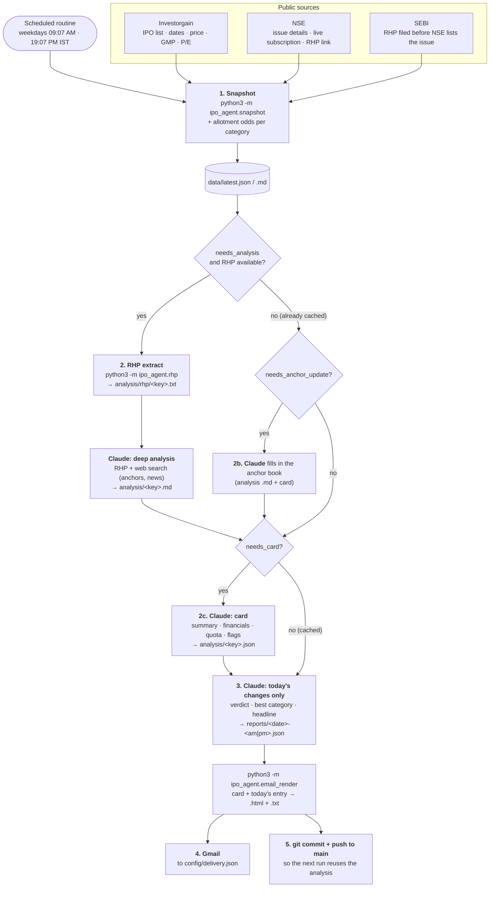

# IPO research agent

A scheduled Claude Code routine that researches **Indian mainboard IPOs** (SME issues are excluded) twice
every weekday and emails a short brief: which IPOs are open or coming up, what the company does, whether
the numbers justify applying, and **which category (Retail / Small HNI / Big HNI) gives the best odds per
rupee blocked**.

The work is split in two:

- **Python (`ipo_agent/`)** does what has to be exact and repeatable: it fetches numbers, extracts the RHP
  (Red Herring Prospectus), works out the allotment maths and renders the email. It uses only the standard
  library.
- **Claude** does what needs judgement: it reads the RHP, searches the web for anchor investors and news,
  writes the deep analysis and gives each IPO a verdict.

Anything that doesn't change with the market is researched **once per IPO** and cached in `analysis/`,
so later runs spend tokens only on what moved (GMP, subscription, the day's call).

## How a run works



The full step-by-step instructions Claude follows are in [ROUTINE.md](ROUTINE.md).

## What happens to one IPO over its life

The analysis is written **once** and reused by every later run, so the cost of reading an RHP is paid
only once per IPO. Later runs just refresh the numbers (GMP, subscription) and the verdict.

| Cached once per IPO (`analysis/`) | Refreshed every run |
|---|---|
| `rhp/<key>.txt`: extracted RHP sections | Dates, price band, lot, GMP, P/E (snapshot) |
| `<key>.md`: deep analysis | Live subscription and allotment odds (snapshot) |
| `<key>.json`: email card with summary, financials, quota, positives, red flags, anchor book, baseline verdict | Verdict override, best category, note, headline (report JSON) |

The snapshot flags only what is missing: `needs_analysis` (no `.md`), `needs_card` (no card, or only a
`"source": "web"` stub while the RHP analysis now exists) and `needs_anchor_update` (card anchor still
pending but the allocation is done). IPOs without an RHP get a short web-search stub card, so the
company isn't searched again every run. Cards hold facts only: no GMP or "today", since they are reused
for days.

```mermaid
stateDiagram-v2
    direction LR
    [*] --> Announced: appears on Investorgain
    Announced --> RHPFiled: RHP found on SEBI or NSE
    note right of Announced: verdict "pending"<br/>(analysis pending: RHP not filed)
    RHPFiled --> Analysed: rhp.py + Claude write analysis/<key>.md
    Analysed --> AnchorDone: anchor book filled in (2b)
    note right of Analysed: Anchor book "Pending" until<br/>allocation (day before opening)
    AnchorDone --> Open: bidding opens
    Open --> Closed: subscription final
    note right of Open: best category picked from<br/>live subscription each run
    Closed --> Listed: listing day
    Listed --> [*]: scored in data/outcomes.json (dropped from snapshot)
```

## Picking the category

For an open IPO, the snapshot works out each category's minimum application, the capital it blocks, and the
odds of allotment (≈ 1 ÷ times subscribed). The expected gain per rupee blocked is:

```
odds × GMP ÷ price
```

`GMP ÷ price` is the same for every category, so **the least-subscribed category wins**. The odds are a lower
bound, and Retail's real odds are usually further above it than sNII's (many retail bids are for more than one
lot), so when Retail and sNII are close the brief prefers Retail.

| Category | Application size | How allotment works when oversubscribed |
|---|---|---|
| Retail | up to ₹2 L | lottery of one minimum lot per applicant, so apply 1 lot from each family member's PAN |
| Small HNI (sNII) | ₹2 L – ₹10 L | lottery of the minimum sNII application |
| Big HNI (bNII) | above ₹10 L | lottery of the minimum bNII application |

The rules and maths are in [ipo_agent/allotment.py](ipo_agent/allotment.py).

## Repository layout

| Path | What it is |
|---|---|
| [ipo_agent/snapshot.py](ipo_agent/snapshot.py) | Builds the day's IPO list by merging Investorgain and NSE (and SEBI for RHP links). Flags `needs_analysis` / `needs_card` / `needs_anchor_update` and shows each cached card's call. |
| [ipo_agent/investorgain.py](ipo_agent/investorgain.py) | Parses the Investorgain live GMP table. |
| [ipo_agent/nse.py](ipo_agent/nse.py) | NSE public APIs: current/upcoming issues, issue details, category-wise subscription. |
| [ipo_agent/sebi.py](ipo_agent/sebi.py) | Finds an RHP on SEBI's "filed with ROC" list, before NSE publishes it. |
| [ipo_agent/rhp.py](ipo_agent/rhp.py) | Downloads an RHP and keeps only the sections that matter (offer structure, financials, objects, basis of price, business, promoters, risks, MD&A, litigation), about 35k tokens instead of 600k. |
| [ipo_agent/allotment.py](ipo_agent/allotment.py) | Category minimums, allotment odds and the best category. |
| [ipo_agent/cards.py](ipo_agent/cards.py) | Loads the cached per-IPO card and decides when one is missing or stale. The card schema is at the top of the file. |
| [ipo_agent/email_render.py](ipo_agent/email_render.py) | Renders the HTML email and the plain-text version from the snapshot plus each IPO's card, overridden by Claude's verdict JSON for the run. The JSON schema is at the top of the file. |
| [ipo_agent/outcomes.py](ipo_agent/outcomes.py) | Listing-day scorecard: records each listed IPO's listing price and day-1 close (NSE) next to the GMP the night before, our last call before bids closed and the final subscription, then prints gains by call, GMP miss and which signals tracked listing gains. |
| [ipo_agent/net.py](ipo_agent/net.py) | Small HTTP client with a cookie jar, browser headers and retries. |
| `data/latest.{json,md}` | The latest snapshot. Older ones are kept in `data/snapshots/`. |
| `data/outcomes.json` | One record per listed IPO: what we expected vs how it listed. |
| `analysis/<key>.md` | Cached deep analysis per IPO. `analysis/rhp/<key>.txt` holds the extracted RHP text. |
| `analysis/<key>.json` | Cached email card per IPO, reused by every run. |
| `reports/<date>-<am\|pm>.{json,html,txt}` | Claude's verdicts and the rendered email for each run. |
| [config/delivery.json](config/delivery.json) | Email recipient. |
| [ROUTINE.md](ROUTINE.md) | What Claude does on each scheduled run. |
| [SETUP.md](SETUP.md) | How to create the routine, cloud environment and Gmail connector. |

## Running it locally

Requires Python 3.9+ and `pdftotext` (from `poppler-utils`). `pypdf` is used as a fallback if it is installed.

```bash
# Fetch today's numbers and print the digest
python3 -m ipo_agent.snapshot --print

# Extract the key sections of an RHP (by NSE symbol or by a PDF/zip URL)
python3 -m ipo_agent.rhp TONBO --out analysis/rhp/tonbo-imaging.txt

# Render the email from a verdict file
python3 -m ipo_agent.email_render reports/2026-10-12-pm.json

# Record IPOs that have listed and print the scorecard (--no-fetch: just print it)
python3 -m ipo_agent.outcomes
```

The verdicts and the deep analysis are written by Claude, so a full brief needs the routine (or a Claude Code
session told to follow `ROUTINE.md`). To set up the scheduled routine, see [SETUP.md](SETUP.md).

## Limits

- NSE often blocks cloud IPs. When it does, the snapshot records the error and Claude fills the missing
  numbers from web search and says so in the email.
- GMP (grey market premium) is unofficial and can change quickly. The odds are a conservative estimate, not
  a promise.
- This is personal research, not investment advice.
