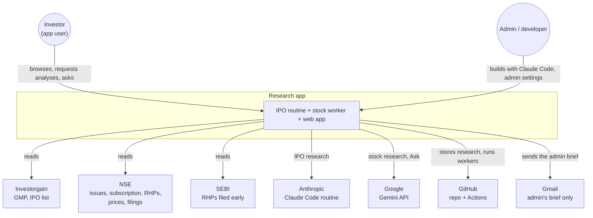
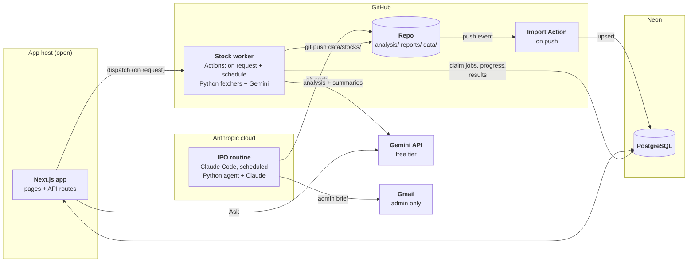
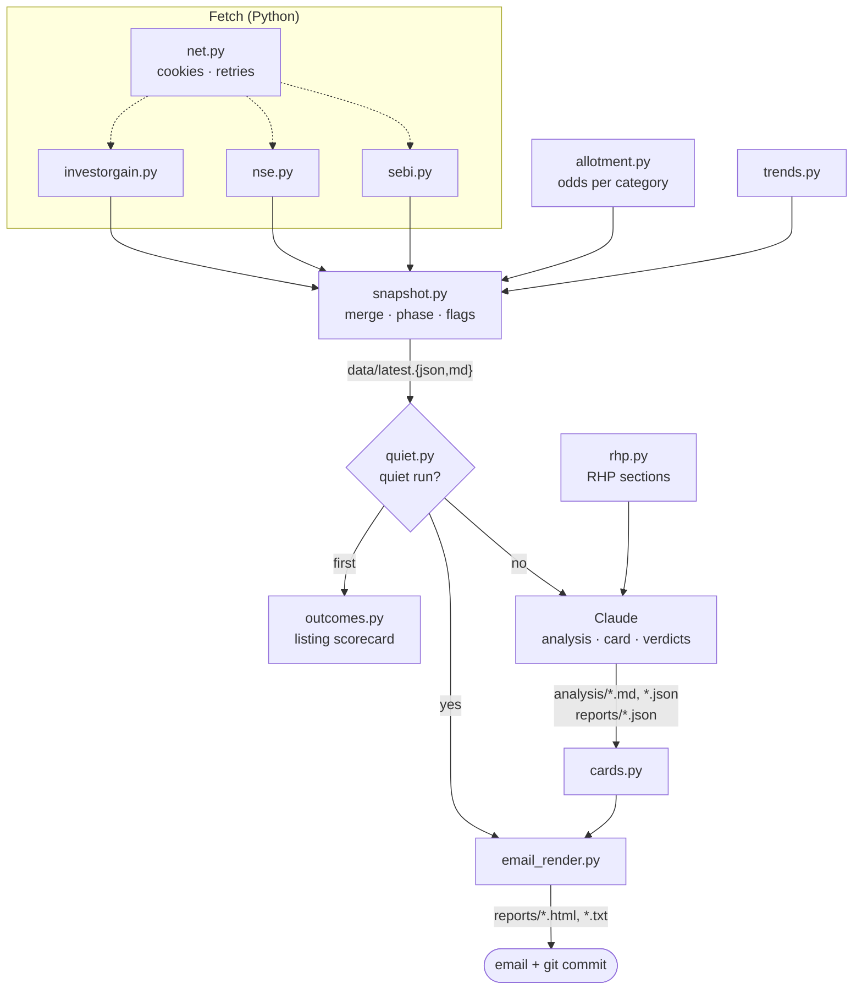
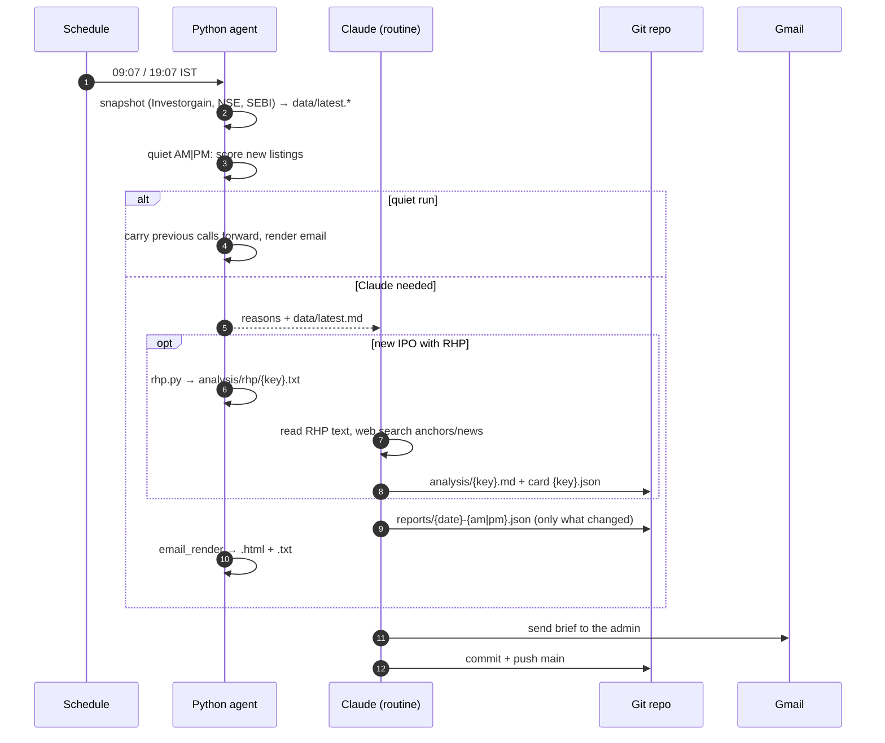
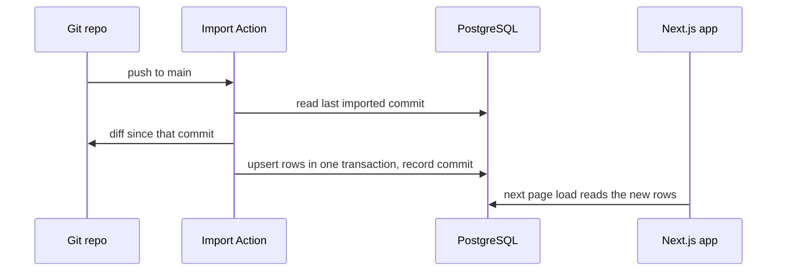
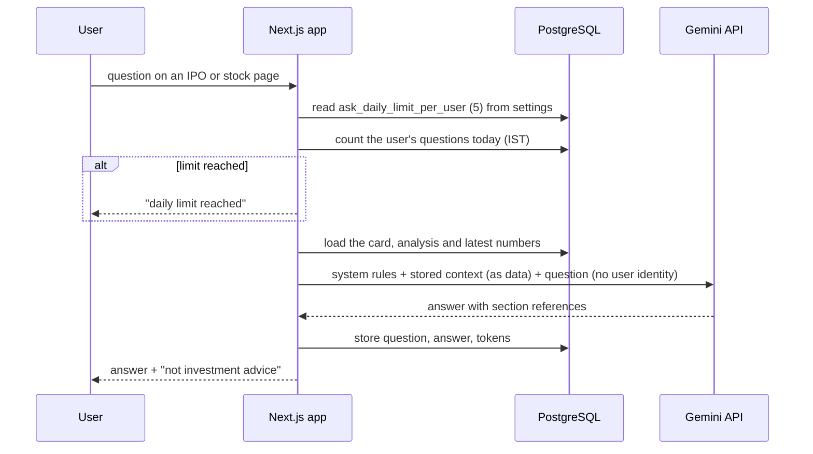

# Architecture

How the system is put together and why. This doc covers the **structure**: context, containers, components, runtime flows, deployment and cross-cutting concerns.

- The stack (frameworks, libraries, tools): [tech.md](tech.md)
- The database: [db.md](db.md)
- The AI design: [ai.md](ai.md)
- The decisions in full: [adr/](adr/README.md)

Status labels (**Running**, **Decided**, **Proposed**, **Open**) are defined in [docs/README.md](README.md#status-labels).

**Two research engines, one per domain** ([ADR-0017](adr/0017-gemini-for-stocks-claude-for-ipos.md)):

| Domain | Engine | AI | Runs |
| --- | --- | --- | --- |
| IPOs | Research routine (Claude Code, personal Pro account) | Claude | On a schedule, twice each weekday |
| Listed stocks | Stock worker | Gemini (free tier) | On a schedule for watched stocks' filings, and on request for a full analysis |

The Claude Pro account is used only for IPOs.

## 1. Goals and quality attributes

| Attribute | What it means here | How the architecture gets it |
| --- | --- | --- |
| **Correct numbers** | Prices, lots, subscription, odds and financials must be exact | Python computes every number; the AI only explains them and cites the source ([ADR-0001](adr/0001-python-for-exact-work-claude-for-judgement.md)) |
| **Low, predictable AI cost** | Phase 1 has no payments; free tiers must hold | IPO research runs on a schedule on an existing plan; each IPO, filing and stock analysis is saved and reused; per-user quotas and a platform cap keep Gemini inside its free quota ([ADR-0004](adr/0004-analyse-once-and-cache.md), [0006](adr/0006-quiet-runs.md), [0013](adr/0013-shared-per-stock-research.md), [0017](adr/0017-gemini-for-stocks-claude-for-ipos.md)) |
| **Auditable calls** | Anyone can see what the AI said, when, and how it turned out | Every research output is committed to git; the listing scorecard grades each IPO call ([ADR-0007](adr/0007-listing-scorecard-as-eval.md), [0011](adr/0011-git-as-the-hand-off.md)) |
| **Survives flaky sources** | NSE blocks cloud IPs; sites change | Each source fails on its own, errors are reported, gaps are labelled, work retries next run ([data-sources.md](data-sources.md)) |
| **No waiting on a page** | Users never wait on a page while AI reads documents | Stored results load at once. A new or refreshed stock analysis runs in the background behind a live progress screen |
| **Privacy** | Users' emails and watchlists stay private | User data lives only in the database, never in git; no user identity goes into any AI prompt |
| **Easy for AI to work on** | DeepSeek builds, Claude reviews, Claude runs the IPO routine | Small modules with one job each; instructions in the repo (`AGENTS.md`, `CLAUDE.md`, `ROUTINE.md`); docs updated with the code ([ADR-0019](adr/0019-deepseek-builds-claude-reviews.md)) |

## 2. System context

## 3. Containers

| Container | Status | Responsibility | Owns |
| --- | --- | --- | --- |
| IPO routine | **Running** | IPO research only: fetch, extract RHPs, compute numbers, have Claude analyse what's new, render the admin brief, commit | Nothing at rest; writes to the repo |
| Stock worker | **Decided**: Gemini, on GitHub Actions ([ADR-0018](adr/0018-stock-worker-on-github-actions.md)) | Watched stocks' filings on a schedule; full stock analyses on request; writes progress and results to the database and files to git | Nothing at rest |
| Repo | **Running** | System of record for all research output; audit trail | `analysis/`, `reports/`, `data/` |
| Import Action | **Decided** | Turn each push into database rows, idempotently | Import log |
| PostgreSQL (Neon) | **Decided** | Serve the app: research copied from git, plus app-owned data | Users, watchlists, analysis jobs and requests, Ask history, settings |
| Next.js app | **Decided** | Pages, accounts, watchlist, analysis requests and progress, Ask, admin settings | Sessions, user actions |
| Gemini API | **Decided** ([ADR-0014](adr/0014-gemini-free-api-for-ask.md), [0017](adr/0017-gemini-for-stocks-claude-for-ipos.md)) | Ask answers; stock analyses; filing summaries | — |
| Gmail (connector on the routine's account) | **Running** | The IPO brief, to the admin only ([ADR-0015](adr/0015-email-to-admin-only.md)) | — |

**Two kinds of data, two owners.**

- **Research data** (IPOs, snapshots, cards, verdicts, outcomes, filings, summaries, stock analyses) is owned by **git**. The database holds a copy that can be rebuilt by replaying the repo ([ADR-0011](adr/0011-git-as-the-hand-off.md)). The stock worker also writes its results straight to the database, so users don't wait for the import. The import re-applies the same rows and changes nothing.
- **App data** (users, watchlists, analysis jobs and requests, Ask history, platform settings) is owned by the **database** and never goes to git.

## 4. Components

### 4.1 IPO routine (Running)

The pipeline that runs at 09:07 and 19:07 IST on weekdays. Each box is a Python module or a Claude step from [ROUTINE.md](../ROUTINE.md).

**Who decides what.** Python decides **whether** Claude is needed: `needs_analysis`, `needs_card` and `needs_anchor_update` are computed in `snapshot.py`, and the quiet-run test is in `quiet.py`. Claude decides **what** to say. Claude doesn't choose what to redo, so it doesn't spend tokens rereading cached work.

### 4.2 Stock worker (Decided)

A separate worker for listed stocks, using Gemini ([ADR-0017](adr/0017-gemini-for-stocks-claude-for-ipos.md)). It runs on GitHub Actions ([ADR-0018](adr/0018-stock-worker-on-github-actions.md)). It reuses the agent's standard-library Python fetchers (`net.py`, NSE client) for every number, and calls the Gemini API for the writing.

**Mode 1: scheduled filings (twice each weekday).**

| Step | Who | Output |
| --- | --- | --- |
| 1. Read the distinct watched symbols from the database | Worker | Symbols only, no user data |
| 2. Fetch quotes, results, announcements, shareholding and pledges since the last run | Python | Raw filings |
| 3. Compute changes and alert candidates (pledge up, promoter holding down, big FII/DII moves) | Python | Rule-based flags with numbers |
| 4. Summarise each **new** result or announcement and rate its importance; explain each flag | Gemini | One summary per filing |
| 5. Write the rows to the database, and the files to `data/stocks/<SYMBOL>/…` in git | Worker | Shared by every user watching the stock |

**Mode 2: analysis on request (dispatched by the app).**

1. **Claim the queue.** The worker claims every `queued` job in one statement, and keeps claiming until the queue is empty. A dispatch that GitHub drops or merges loses nothing.
2. **Work through each stock, reporting every step.** Each step's start and end goes into `analysis_job_events`: price and valuation, the last 8 quarterly results, shareholding and pledges, announcements, news, writing, saving.
   - **Numbers:** Python fetches them.
   - **Writing:** Gemini writes the analysis from those numbers, using a template like the IPO one.
   - **News:** news comes from Gemini's Google Search grounding, if the free tier allows it for the chosen model. If it doesn't, the step records "news not checked" and the analysis says so.
3. **Save the result.** The worker writes `stock_analyses` and marks the job `done`, then commits `data/stocks/<SYMBOL>/analysis.{md,json}`.

Scheduled runs also take any jobs still queued.

### 4.3 Import Action (Decided)

| Concern | Design |
| --- | --- |
| Trigger | Push to `main` that touches `analysis/`, `reports/` or `data/` |
| Unit of work | One commit; files changed since the last imported commit |
| Idempotency | Upserts keyed on natural keys (IPO key, snapshot time, report date + session, filing ID, stock symbol); re-running a commit changes nothing |
| Bookkeeping | `imports` table records the last commit imported; a failed import retries from there |
| Rebuild | A full replay of the repo recreates every research table ([db.md](db.md#import-and-rebuild)) |

### 4.4 Next.js app (Decided)

| Module | Pages / routes | Notes |
| --- | --- | --- |
| IPOs | Today, IPO detail (analysis, trends, odds, anchor book) | Read-only, from research tables |
| Track record | Calls vs listing, GMP accuracy, signal correlations | Read-only, from `ipo_outcomes` |
| Watchlist | List, stock detail (price, results, announcements, shareholding, alerts) | Per user; adding a stock is free |
| Analysis | "Get analysis" on a stock; loading screen with queue position and live steps | **Every request counts** against the monthly quota (3), whether the saved analysis is served or refreshed ([ADR-0017](adr/0017-gemini-for-stocks-claude-for-ipos.md)) |
| Ask | Question box on IPO and stock pages | Gemini API; 5 questions a day per person ([ai.md](ai.md#in-app-ai-ask)) |
| Accounts | Sign-up, sign-in | Auth library ([ADR](adr/README.md) to come); Google sign-in or password, because the app sends no email ([ADR-0015](adr/0015-email-to-admin-only.md)) |
| Alerts | Shown on the watchlist and stock pages | In the app only; users get no email |
| Admin | Settings page (admin role only) | Edits [`settings`](db.md#settings): quotas and caps |
| Worker dispatch | Server-side call to start the stock worker | Token in the app's environment only; sends no user text |

## 5. Runtime flows

### 5.1 Scheduled IPO run (Running)

### 5.2 Research → database (Decided)

### 5.3 A user asks for a stock analysis (Decided)

```mermaid
sequenceDiagram
    participant U as User
    participant W as Next.js app
    participant D as PostgreSQL
    participant K as Stock worker
    participant M as Gemini API
    U->>W: Get analysis for HDFCBANK
    W->>D: monthly quota left? (every request counts)
    alt quota used up
        W-->>U: "3 of 3 used this month"
    else quota left
        W->>D: record request (charged)
        alt saved analysis is fresh
            W-->>U: show it at once
        else none saved, or saved one is out of date
            W->>D: find or create the open job
            W-->>U: loading screen (queue position)
            opt no worker running and today's platform cap not reached
                W->>K: dispatch
            end
            K->>D: claim queued jobs
            loop each step
                K->>D: insert analysis_job_events
                U->>W: poll status
                W-->>U: current step, what's next
            end
            K->>M: write analysis from the fetched numbers
            K->>D: save stock_analyses, job done
            K->>K: commit data/stocks/HDFCBANK/analysis.*
            U->>W: poll status
            W-->>U: open the analysis
        end
    end
```

**When a saved analysis is out of date** (**Decided**): it's older than `analysis_refresh_after_days` (30), or the company has filed a newer quarterly result than the one it used. While a refresh runs, the loading screen links to the previous version and shows its date.

### 5.4 Ask about an IPO or stock (Decided)

## 6. Deployment

| Piece | Runs on | Status | Config and secrets |
| --- | --- | --- | --- |
| IPO routine | Claude Code cloud environment on the personal Pro account, network allowlist ([SETUP.md](../SETUP.md)) | **Running** | Gmail connector; GitHub access to the repo |
| Repo, Import Action | GitHub | Repo **Running**; Action **Decided** | Action secret: database URL |
| Stock worker | GitHub Actions ([ADR-0018](adr/0018-stock-worker-on-github-actions.md)) | **Decided** | Action secrets: database URL, Gemini API key |
| Database | Neon free tier; a branch per test run and preview | **Decided** | Connection strings per branch |
| Next.js app | Host **Open**; local until week 4 | **Decided** | Database URL, Gemini API key, auth secret, worker dispatch token |

The worker writes progress to the database itself, so it never needs to reach the app. Hosting can stay in week 4.

## 7. Cross-cutting concerns

### 7.1 Security and trust boundaries

| Boundary | Risk | Control |
| --- | --- | --- |
| Scraped pages, RHPs, filings → AI | Prompt injection hidden in a document | Documents are passed as data, never as instructions. The IPO routine has only the Gmail connector and repo access. Gemini calls (worker and Ask) have no tools except search grounding, so injected text can at most change the written text |
| App → stock worker | User text steering a research run | The dispatch carries no user text. The worker reads job rows whose symbols were checked against the stocks list. The dispatch token lives only in the app's environment |
| Users → app | Account takeover, data leaks between users | Auth library, sessions in Postgres, every query scoped to the signed-in user, CSRF protection, rate limits on sign-in, Ask and analysis requests |
| App and worker → Gemini API | Shared free quota used up; user data reaching Google (free-tier prompts may be used to improve Google's products) | Per-user quotas and a platform cap on analyses a day; prompts carry only public-source data and the user's question, never identity; the app says questions and analyses use Gemini |
| Secrets | Exposure in git | Secrets only in GitHub Action secrets and the app's environment; no user data and no secrets in the repo |

### 7.2 Failure handling

| Failure | Effect | Handling |
| --- | --- | --- |
| NSE blocks the routine or the worker | Missing numbers | Reported; the IPO brief fills from web search and says so; a stock analysis marks the missing section "not available" |
| Investorgain layout changes | No GMP or IPO list | Parser error reported; the run continues with NSE data |
| Listing prices not out yet | No scorecard row | `outcomes` retries next run |
| Claude step fails mid-run | No new IPO verdicts | The next run still has the cached cards; the quiet path can still render |
| Import fails | Database behind git | Retries from the last imported commit; the app shows the "as of" time |
| Neon paused (free tier) | Slow first query | Accepted; warm before demos |
| Gemini down or free quota used up | Ask or analyses unavailable | Ask says so; analysis jobs stay queued for the next run; the loading screen says why |
| Platform cap reached (`analysis_daily_limit_platform`) | Job waits | Stays queued until the next day's first worker run; the loading screen says so |
| Worker stalls or fails | Job stuck | No event for 30 minutes → `failed` and re-queued; the user's request is refunded |
| Search grounding not available on the free tier | No news section | The news step is marked "not checked", and the analysis says so |

### 7.3 Cost model (phase 1: no payments)

| Cost driver | Grows with | Kept within free limits by |
| --- | --- | --- |
| IPO research (Claude) | New IPOs (a few a week) | Once per IPO, cached; quiet runs skip Claude; uses the existing personal Pro plan |
| Filing summaries (Gemini) | New filings of **distinct** watched stocks | Once per filing, shared by all users |
| Stock analyses (Gemini) | Analysis requests | Saved and reused while fresh; 3 requests per person a month; platform cap a day |
| Ask (Gemini) | User questions | 5 a day per person |
| Worker minutes (GitHub Actions) | Worker runs | One run handles the whole queue; free minutes for private repos (about 2,000 a month per third-party sources; check GitHub's billing page) |
| Database | Rows stored | RHP text stays in git; announcement bodies are not stored ([db.md](db.md#sizing-and-retention)) |

All Gemini work (Ask, analyses, filing summaries) shares one free quota per Google project. The quotas and the platform cap are set together so that a busy day of analyses can't use up Ask ([ADR-0017](adr/0017-gemini-for-stocks-claude-for-ipos.md)).

### 7.4 Observability

| Signal | Where |
| --- | --- |
| What an IPO run did | The routine transcript, plus the commit it pushed |
| What a worker run did | The Actions run log, and `analysis_job_events` |
| Source errors | `data/latest.json` → `errors`; job events for stock work |
| How good the IPO calls are | `python3 -m ipo_agent.outcomes --no-fetch` and the track record page |
| Import health | `imports` table: last commit, status, error |
| Gemini usage against the free quota | `ai_questions` and `analysis_jobs` counts per day |

## 8. Decisions

| ADR | Decision | Status |
| --- | --- | --- |
| [0001](adr/0001-python-for-exact-work-claude-for-judgement.md) | Python for exact work, Claude for judgement | Accepted |
| [0002](adr/0002-standard-library-only-agent.md) | Research agent uses the Python standard library only | Accepted |
| [0003](adr/0003-research-on-a-schedule.md) | Research runs on a schedule, not on request | Accepted (IPO research) |
| [0004](adr/0004-analyse-once-and-cache.md) | Analyse each IPO once and cache it | Accepted |
| [0005](adr/0005-email-rendered-from-json.md) | Email rendered from Claude's JSON verdicts | Accepted |
| [0006](adr/0006-quiet-runs.md) | Quiet runs skip Claude | Accepted |
| [0007](adr/0007-listing-scorecard-as-eval.md) | Listing scorecard is the eval of the AI's calls | Accepted |
| [0008](adr/0008-mainboard-only.md) | Mainboard IPOs only; SME out of scope | Accepted |
| [0009](adr/0009-nextjs-web-platform.md) | Next.js for the web platform | Accepted |
| [0010](adr/0010-postgresql-on-neon.md) | PostgreSQL on Neon | Accepted |
| [0011](adr/0011-git-as-the-hand-off.md) | Git is the hand-off; the database copy of research is rebuildable | Accepted |
| [0012](adr/0012-research-not-advice.md) | Research, not advice, for listed stocks | Accepted |
| [0013](adr/0013-shared-per-stock-research.md) | Research is per stock and shared across users | Accepted |
| [0014](adr/0014-gemini-free-api-for-ask.md) | Gemini API (free tier) for in-app Ask | Accepted |
| [0015](adr/0015-email-to-admin-only.md) | Email goes to the admin only; no user emails | Accepted |
| [0016](adr/0016-on-demand-stock-analysis.md) | On-demand stock analysis through the Claude routine | Superseded by 0017 |
| [0017](adr/0017-gemini-for-stocks-claude-for-ipos.md) | Claude for IPOs only; Gemini for all stock work; every analysis request counts | Accepted |
| [0018](adr/0018-stock-worker-on-github-actions.md) | Stock worker runs on GitHub Actions | Accepted |
| [0019](adr/0019-deepseek-builds-claude-reviews.md) | DeepSeek plans and builds; Claude reviews the plan and the code | Accepted |
| [0020](adr/0020-shadcn-ui.md) | shadcn/ui and Tailwind CSS for the web app | Accepted |

## 9. Open questions

| Question | Affects | Needed by |
| --- | --- | --- |
| Does NSE answer requests from GitHub's runners? | Every stock number | Week 1 smoke test |
| Gemini free quotas and grounding for the chosen model (read in AI Studio) | Quotas, platform cap, news step | Week 1 |
| App host | Deployment, secrets | Week 4 |
| Auth library and ORM | Accounts, schema migrations | Week 1 |
| Confirmed NSE endpoints for stock quotes, results, shareholding, announcements and pledges | Stock worker | Week 1 (003 confirmed announcements, equity list and standalone results; quote, consolidated results, FII/DII split, pledge symbol and filing links still unconfirmed) |
| Backups for app-owned data (Neon free tier keeps a short history) | Users, watchlists | Before real users |
| Same repo or separate repo for the app | Import Action, CI, worker | Week 1 |
