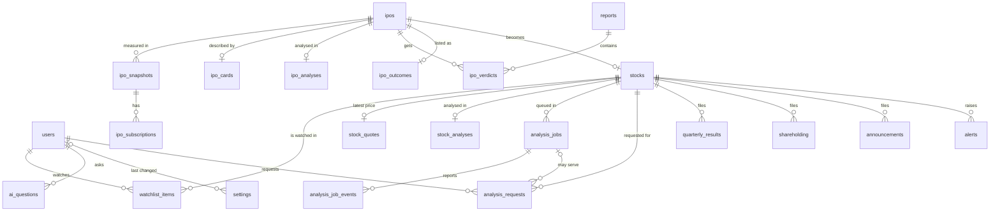

# Database

PostgreSQL on Neon ([ADR-0010](adr/0010-postgresql-on-neon.md)). The schema below is **Decided** as the starting point: Claude drafted it from the routine's existing JSON, and the human accepted it on 2026-10-29. It isn't built yet, and details may change while we build. The auth tables will take whatever shape the auth library needs, which is still **Open**.

The design starts from data that exists today. Every research table below maps to a JSON file the routine already writes; the mapping is in [§ Where the data comes from](#where-the-data-comes-from).

## Principles

1. **Two owners.** **Research tables** are a copy of git and can be rebuilt by replaying the repo ([ADR-0011](adr/0011-git-as-the-hand-off.md)). **App tables** (users, watchlists, Ask history, analysis jobs and requests, platform settings) exist only here.
2. **Natural keys for research data.** IPO key (`zetwerk`), NSE symbol (`HDFCBANK`), report date + session, the exchange's filing ID. Re-importing the same file updates the same row, so imports are idempotent.
3. **Columns for what we query, `jsonb` only for what we display whole.** Verdict, subscription and financial figures are typed columns because the track record and trends filter and aggregate them. The allotment table per snapshot is `jsonb`: it's derived, always shown whole, and never filtered.
4. **AI output is labelled.** Every column an AI writes sits next to provenance columns: `ai_model`, `ai_prompt_version` and `ai_written_at`. `ai_model` names the model that actually wrote the file, copied as the ID the writer's system prompt gives it — the ID as stamped, not the display name (e.g. `claude-sonnet-5-5` for IPOs, `gemini-…` for stocks, [ADR-0017](adr/0017-gemini-for-stocks-claude-for-ipos.md)) — so anyone can see which text came from which AI and instruction version.
5. **Money in `numeric`, never `float`.** Prices in rupees as `numeric(12,2)`; issue sizes and financials in ₹ crore as `numeric(14,2)`; percentages as `numeric(7,2)`.
6. **Times in `timestamptz`, dates in `date`.** Values are stored with their time zone and shown in IST.
7. **Ownership in every user query.** Every app table has `user_id`, and every query filters on it.

## Entity diagram

An IPO that lists **becomes a stock** (`stocks.ipo_key`). A user can move from "should I apply?" to watching the company in one click, and the IPO's analysis stays linked.

## Enums

| Type | Values | Source |
| --- | --- | --- |
| `ipo_phase` | `announced`, `upcoming`, `open`, `closing_today`, `awaiting_listing`, `listing_today`, `listed` | `snapshot.phase()` |
| `verdict` | `apply`, `listing_gains`, `neutral`, `avoid`, `pending` | Card and report schemas |
| `anchor_grade` | `strong`, `average`, `weak`, `pending` | Card schema |
| `card_source` | `rhp`, `web` | Card schema |
| `rhp_source` | `nse`, `sebi` | Snapshot |
| `report_session` | `AM`, `PM` | Report schema |
| `sub_category` | `qib`, `nii`, `snii`, `bnii`, `retail`, `employee`, `total` | NSE subscription |
| `importance` | `high`, `medium`, `low`, `routine` | Gemini's rating of an announcement |
| `job_status` | `queued`, `running`, `done`, `failed` | On-demand analysis jobs |
| `analysis_served` | `saved`, `new`, `refresh` | What an analysis request got |
| `alert_kind` | `results`, `announcement`, `pledge_up`, `promoter_down`, `fii_move`, `dii_move` | Alert rules |
| `severity` | `info`, `watch`, `warning` | Alert rules |

## Research tables: IPOs

### `ipos`

One row per IPO. Key facts that change rarely, merged from Investorgain, NSE and SEBI.

| Column | Type | Null | Notes |
| --- | --- | --- | --- |
| `key` | `text` | PK | Slug, e.g. `zetwerk`; same as the file names in `analysis/` |
| `name` | `text` | no | |
| `symbol` | `text` | yes | NSE symbol; null until NSE lists the issue |
| `open_date`, `close_date` | `date` | yes | Null while only announced |
| `allotment_date`, `listing_date` | `date` | yes | |
| `price_low`, `price_high` | `numeric(12,2)` | yes | Price band |
| `lot_size` | `integer` | yes | Shares per lot |
| `issue_size_cr` | `numeric(14,2)` | yes | |
| `issue_size_text` | `text` | yes | NSE's description (fresh issue, OFS, anchor portion) |
| `face_value` | `text` | yes | |
| `lead_managers`, `registrar` | `text` | yes | |
| `rhp_url` | `text` | yes | |
| `rhp_source` | `rhp_source` | yes | |
| `investorgain_url` | `text` | yes | |
| `phase` | `ipo_phase` | no | Latest phase |
| `anchor_done` | `boolean` | no | Default `false` |
| `updated_at` | `timestamptz` | no | |

Indexes: `(phase)`, `(listing_date)`, unique `(symbol) where symbol is not null`.

### `ipo_snapshots`

One row per IPO per run: the numbers that move.

| Column | Type | Null | Notes |
| --- | --- | --- | --- |
| `ipo_key` | `text` | PK, FK → `ipos` | |
| `taken_at` | `timestamptz` | PK | `generated_at` of the snapshot |
| `phase` | `ipo_phase` | no | Phase at that run |
| `gmp`, `gmp_low`, `gmp_high` | `numeric(12,2)` | yes | ₹ |
| `gmp_pct` | `numeric(7,2)` | yes | |
| `gmp_updated` | `text` | yes | Investorgain's own timestamp text, kept as given |
| `pe` | `numeric(10,2)` | yes | |
| `allotment` | `jsonb` | yes | Per-category minimum, odds and return on blocked capital (`categories` in the snapshot); derived and shown whole |
| `source_file` | `text` | no | e.g. `data/snapshots/2026-10-29T0907.json` |

Index: `(ipo_key, taken_at desc)` for the latest snapshot and for trends.

### `ipo_subscriptions`

Subscription by category for each snapshot. A narrow table so "retail subscription by day" is one indexed query.

| Column | Type | Null | Notes |
| --- | --- | --- | --- |
| `ipo_key` | `text` | PK | |
| `taken_at` | `timestamptz` | PK | FK → `ipo_snapshots (ipo_key, taken_at)` |
| `category` | `sub_category` | PK | |
| `shares_offered` | `bigint` | yes | |
| `shares_bid` | `bigint` | yes | |
| `times` | `numeric(10,2)` | yes | Times subscribed |

### `ipo_cards`

The cached facts card: one per IPO, written once from the analysis ([ADR-0004](adr/0004-analyse-once-and-cache.md)).

| Column | Type | Null | Notes |
| --- | --- | --- | --- |
| `ipo_key` | `text` | PK, FK → `ipos` | |
| `source` | `card_source` | no | `web` stub before the RHP is filed, then `rhp` |
| `analysed_on` | `date` | yes | |
| `verdict` | `verdict` | no | Baseline call |
| `verdict_text` | `text` | no | |
| `summary` | `text` | yes | What the company does |
| `financials` | `text` | yes | One line, ₹ Cr |
| `quota` | `text` | yes | From the RHP's offer structure |
| `positives` | `text[]` | no | Default `{}` |
| `red_flags` | `text[]` | no | Default `{}` |
| `anchor` | `text` | yes | |
| `anchor_grade` | `anchor_grade` | no | |
| `ai_model`, `ai_prompt_version` | `text` | yes | Provenance |
| `ai_written_at` | `timestamptz` | yes | |
| `source_file` | `text` | no | `analysis/<key>.json` |

### `ipo_analyses`

The full deep analysis in Markdown (a few KB each). The RHP text itself stays in git.

| Column | Type | Null | Notes |
| --- | --- | --- | --- |
| `ipo_key` | `text` | PK, FK → `ipos` | |
| `markdown` | `text` | no | `analysis/<key>.md` |
| `rhp_text_path` | `text` | yes | `analysis/rhp/<key>.txt` in git |
| `ai_model`, `ai_prompt_version`, `ai_written_at` | | | Provenance |
| `content_sha` | `text` | no | Skip the update if unchanged |

### `reports`

One row per run: the brief's headline and notes.

| Column | Type | Null | Notes |
| --- | --- | --- | --- |
| `report_date` | `date` | PK | |
| `session` | `report_session` | PK | |
| `headline` | `text` | yes | |
| `notes` | `text[]` | no | Default `{}` |
| `quiet` | `boolean` | no | `true` when the file has `"generated": "quiet"` (written by `quiet.py`, not Claude) |
| `carried_from` | `text` | yes | For quiet runs: the earlier report whose calls were carried forward |
| `ai_model`, `ai_prompt_version` | `text` | yes | Provenance; absent on quiet runs (code-written); a quiet report's carried calls carry it on the `carried_from` report |
| `ai_written_at` | `timestamptz` | yes | |
| `commit_sha` | `text` | yes | The commit that added it |
| `source_file` | `text` | no | `reports/<date>-<am\|pm>.json` |

### `ipo_verdicts`

The day's call per IPO, from the report. Only the fields that changed are present; the app shows `coalesce(verdict, card.verdict)`. Provenance sits on the report (`reports`); verdicts inherit it from their report.

| Column | Type | Null | Notes |
| --- | --- | --- | --- |
| `report_date`, `session` | | PK, FK → `reports` | |
| `ipo_key` | `text` | PK, FK → `ipos` | |
| `verdict` | `verdict` | yes | Null = the card's call holds |
| `verdict_text` | `text` | yes | |
| `best_category` | `text` | yes | `Retail`, `sNII`, `bNII` or null |
| `category_note` | `text` | yes | |
| `overrides` | `jsonb` | yes | Any other card field overridden for the day |

Index: `(ipo_key, report_date desc, session desc)` for the latest call.

### `ipo_outcomes`

The listing-day scorecard: one row per listed IPO (`data/outcomes.json`). Subscription is stored as columns so correlation queries stay simple.

| Column | Type | Null | Notes |
| --- | --- | --- | --- |
| `ipo_key` | `text` | PK, FK → `ipos` | |
| `symbol` | `text` | no | |
| `listing_date` | `date` | no | |
| `issue_price`, `listing_price` | `numeric(12,2)` | no | |
| `day_close`, `day_high`, `day_low` | `numeric(12,2)` | yes | |
| `listing_gain_pct`, `close_gain_pct` | `numeric(7,2)` | yes | |
| `gmp_eve`, `gmp_eve_pct` | `numeric(12,2)`, `numeric(7,2)` | yes | GMP the night before |
| `gmp_eve_snapshot` | `timestamptz` | yes | |
| `gmp_miss_pts` | `numeric(7,2)` | yes | Listing gain minus GMP %; + = above GMP |
| `verdict`, `verdict_text`, `best_category` | | yes | Our last call before bids closed |
| `verdict_report` | `text` | yes | Which report held that call |
| `anchor_grade` | `anchor_grade` | yes | |
| `pe`, `size_cr` | `numeric` | yes | |
| `sub_qib`, `sub_snii`, `sub_bnii`, `sub_retail`, `sub_total` | `numeric(10,2)` | yes | Final subscription (times) |
| `subscription_source`, `price_source` | `text` | yes | |
| `recorded_at` | `timestamptz` | no | |

## Research tables: stocks

### `stocks`

| Column | Type | Null | Notes |
| --- | --- | --- | --- |
| `symbol` | `text` | PK | NSE symbol |
| `isin` | `text` | yes | Unique when present |
| `name` | `text` | no | |
| `industry` | `text` | yes | |
| `ipo_key` | `text` | yes | FK → `ipos`; set when an IPO we covered lists |
| `active` | `boolean` | no | `false` if delisted or suspended |
| `last_researched_at` | `timestamptz` | yes | Last run that fetched it |

### `stock_analyses`

The full analysis of a listed company: one per stock, written once and served to every user from here ([ADR-0013](adr/0013-shared-per-stock-research.md)). It's written by the Gemini stock worker on request, and refreshed when it's out of date ([ADR-0017](adr/0017-gemini-for-stocks-claude-for-ipos.md)).

| Column | Type | Null | Notes |
| --- | --- | --- | --- |
| `symbol` | `text` | PK, FK → `stocks` | |
| `summary` | `text` | no | What the company does |
| `financials` | `text` | yes | One line, ₹ Cr |
| `valuation` | `text` | yes | P/E, EV/EBITDA, P/B vs peers |
| `positives`, `red_flags` | `text[]` | no | Default `{}` |
| `markdown` | `text` | no | The full analysis |
| `analysed_on` | `date` | no | |
| `based_on_period` | `date` | yes | Latest quarter used; a newer result marks the analysis as due for refresh |
| `ai_model`, `ai_prompt_version`, `ai_written_at` | | | Provenance |
| `source_file` | `text` | no | `data/stocks/<SYMBOL>/analysis.json` |

### `stock_quotes`

Latest price and valuation, refreshed each run. One row per stock; the app is not a live ticker.

| Column | Type | Null | Notes |
| --- | --- | --- | --- |
| `symbol` | `text` | PK, FK → `stocks` | |
| `price`, `change_pct` | `numeric` | yes | |
| `week52_high`, `week52_low` | `numeric(12,2)` | yes | |
| `market_cap_cr`, `pe` | `numeric` | yes | |
| `as_of` | `timestamptz` | no | |

### `quarterly_results`

| Column | Type | Null | Notes |
| --- | --- | --- | --- |
| `symbol` | `text` | PK, FK → `stocks` | |
| `period_end` | `date` | PK | Quarter end |
| `consolidated` | `boolean` | PK | Standalone and consolidated stored separately |
| `revenue_cr`, `other_income_cr`, `expenses_cr` | `numeric(14,2)` | yes | |
| `ebitda_cr`, `pat_cr` | `numeric(14,2)` | yes | `ebitda_cr`: operating EBITDA `revenue − (total expenses − finance costs − depreciation)` from `re_net_sale`, `re_oth_tot_exp`, `re_int_new`, `re_depr_und_exp` — the 014 fetcher derives it in code, `None` unless all four are stated |
| `eps` | `numeric(10,2)` | yes | ₹ per share; the NSE results API sends it unconverted (014) |
| `filed_at` | `timestamptz` | yes | |
| `source_url` | `text` | yes | Exchange filing |
| `ai_summary` | `text` | yes | What changed and why |
| `ai_model`, `ai_prompt_version`, `ai_written_at` | | | Provenance |

Amounts are the NSE results API's ₹ lakh, converted to crore by 014's tested `to_crore` helper in the fetcher ([data-sources.md](data-sources.md#nse-stock-data)); the API is standalone-only, so `consolidated` is `False` for every fetched row.

Index: `(symbol, period_end desc)`.

### `shareholding`

| Column | Type | Null | Notes |
| --- | --- | --- | --- |
| `symbol` | `text` | PK, FK → `stocks` | |
| `quarter_end` | `date` | PK | |
| `promoter_pct`, `fii_pct`, `dii_pct`, `public_pct`, `other_pct` | `numeric(7,2)` | yes | Share of total equity |
| `promoter_pledged_pct` | `numeric(7,2)` | yes | Share of promoter holding that is pledged; computed by the 014 fetcher as shares pledged ÷ promoter holding × 100 (half-up, 2 dp) — never NSE's `percSharesPledged` |
| `filed_at` | `timestamptz` | yes | |
| `source_url` | `text` | yes | |

Quarter-on-quarter changes come from a SQL window over this table. Python's alert rules use the same comparison.

`fii_pct`/`dii_pct` come later from XBRL parsing (016/018); 014's fetcher leaves them missing, never estimated ([data-sources.md](data-sources.md#nse-stock-data)).

### `announcements`

| Column | Type | Null | Notes |
| --- | --- | --- | --- |
| `id` | `bigint` identity | PK | |
| `symbol` | `text` | no | FK → `stocks` |
| `exchange_ref` | `text` | no | The exchange's own ID; unique; dedupe key |
| `announced_at` | `timestamptz` | no | |
| `subject` | `text` | no | Exchange category |
| `title` | `text` | no | |
| `attachment_url` | `text` | yes | The PDF stays at the exchange |
| `importance` | `importance` | yes | Gemini's rating |
| `ai_summary` | `text` | yes | Null for `routine` |
| `ai_model`, `ai_prompt_version`, `ai_written_at` | | | Provenance |

Indexes: unique `(exchange_ref)`, `(symbol, announced_at desc)`, `(importance, announced_at desc) where importance in ('high','medium')`.

### `alerts`

Alerts belong to a stock, not to a user. Users see the alerts of the stocks they watch.

| Column | Type | Null | Notes |
| --- | --- | --- | --- |
| `id` | `bigint` identity | PK | |
| `symbol` | `text` | no | FK → `stocks` |
| `kind` | `alert_kind` | no | |
| `severity` | `severity` | no | |
| `title` | `text` | no | e.g. "Promoter pledge up from 4% to 11%" (numbers from Python) |
| `detail` | `text` | yes | Gemini's explanation |
| `dedupe_key` | `text` | no | Unique, e.g. `HDFCBANK:pledge_up:2026-09-30` |
| `source_table`, `source_id` | `text` | yes | The row that triggered it |
| `created_at` | `timestamptz` | no | |

Index: `(symbol, created_at desc)`.

## App tables

### `users`

The final shape follows the auth library (**Open**). These are the fields the app itself needs.

| Column | Type | Null | Notes |
| --- | --- | --- | --- |
| `id` | `uuid` | PK | |
| `email` | `citext` | no | Unique |
| `name` | `text` | yes | |
| `role` | `text` | no | `user` or `admin`; default `user`. Only an admin can change `settings` |
| `created_at` | `timestamptz` | no | |

Plus the auth library's own tables (sessions, accounts). Users get no email from the app ([ADR-0015](adr/0015-email-to-admin-only.md)), so sign-in can't rely on emailed links.

### `watchlist_items`

| Column | Type | Null | Notes |
| --- | --- | --- | --- |
| `user_id` | `uuid` | PK, FK → `users` (cascade delete) | |
| `symbol` | `text` | PK, FK → `stocks` | |
| `added_at` | `timestamptz` | no | |

Limit: 50 stocks per user, checked in the app. A view `watched_symbols` (`select distinct symbol`) is all the stock worker reads; it carries no user data.

### `ai_questions`

The Ask history (answers come from the Gemini API, [ADR-0014](adr/0014-gemini-free-api-for-ask.md)). Also the ledger for the per-user daily limit set in [`settings`](#settings). Holds the user's question here only; the prompt sent to Gemini carries no user identity.

| Column | Type | Null | Notes |
| --- | --- | --- | --- |
| `id` | `bigint` identity | PK | |
| `user_id` | `uuid` | no | FK → `users` (cascade delete) |
| `subject_type` | `text` | no | `ipo` or `stock` |
| `subject_key` | `text` | no | IPO key or symbol |
| `question`, `answer` | `text` | no | |
| `model` | `text` | no | |
| `input_tokens`, `output_tokens` | `integer` | no | |
| `created_at` | `timestamptz` | no | |

Index: `(user_id, created_at desc)` for the daily limit check.

### `analysis_jobs`

One row per stock waiting for, or undergoing, a new or refreshed analysis by the stock worker ([ADR-0017](adr/0017-gemini-for-stocks-claude-for-ipos.md)). Users who ask for the same stock share one job.

| Column | Type | Null | Notes |
| --- | --- | --- | --- |
| `id` | `uuid` | PK | |
| `symbol` | `text` | no | FK → `stocks` |
| `status` | `job_status` | no | `queued`, `running`, `done` or `failed` |
| `reason` | `text` | no | `new` (never analysed) or `refresh` (saved one out of date) |
| `current_step` | `text` | yes | Latest step key, e.g. `results` |
| `worker_run_id`, `worker_run_url` | `text` | yes | The worker run that claimed the job (the GitHub Actions run, [ADR-0018](adr/0018-stock-worker-on-github-actions.md)) |
| `queued_at` | `timestamptz` | no | |
| `started_at`, `finished_at` | `timestamptz` | yes | |
| `last_event_at` | `timestamptz` | yes | No event for 30 minutes → `failed` |
| `error` | `text` | yes | |

Indexes:
- unique `(symbol) where status in ('queued','running')`: at most one open job per stock
- `(status, queued_at)`: queue order

### `analysis_job_events`

The progress steps the loading screen shows, written by the stock worker as it goes.

| Column | Type | Null | Notes |
| --- | --- | --- | --- |
| `id` | `bigint` identity | PK | |
| `job_id` | `uuid` | no | FK → `analysis_jobs` (cascade delete) |
| `step` | `text` | no | One of the known steps: `worker_started`, `quote`, `results`, `shareholding`, `announcements`, `news`, `writing`, `saving` |
| `state` | `text` | no | `started` or `done` |
| `message` | `text` | yes | Short line for the screen, e.g. "Reading the last 8 quarterly results" |
| `at` | `timestamptz` | no | |

Index: `(job_id, at)`.

### `analysis_requests`

Every analysis request: who asked for which stock and what they got. This is also the ledger for the monthly quota. **Every request counts**, including one served from a saved analysis ([ADR-0017](adr/0017-gemini-for-stocks-claude-for-ipos.md)).

| Column | Type | Null | Notes |
| --- | --- | --- | --- |
| `id` | `bigint` identity | PK | |
| `user_id` | `uuid` | no | FK → `users` (cascade delete) |
| `symbol` | `text` | no | FK → `stocks` |
| `served` | `analysis_served` | no | `saved` (fresh analysis served), `new` or `refresh` (a job ran) |
| `job_id` | `uuid` | yes | FK → `analysis_jobs`; null when `served = 'saved'` |
| `requested_at` | `timestamptz` | no | |
| `charged` | `boolean` | no | Counts toward the monthly limit. `true` by default; `false` when the same user already has a charged request for the same stock this month (reopening isn't charged twice); set back to `false` if the job fails (refund) |

Index: `(user_id, requested_at desc)` for the monthly count.

### `settings`

Platform settings that an admin can change without a deploy. There is one row per setting, and the value is `jsonb` so each setting can have its own type. The app checks every value against a list of known keys and their types before saving.

| Column | Type | Null | Notes |
| --- | --- | --- | --- |
| `key` | `text` | PK | e.g. `ask_daily_limit_per_user` |
| `value` | `jsonb` | no | Checked against the key's type in the app |
| `description` | `text` | no | Shown on the admin settings page |
| `updated_at` | `timestamptz` | no | |
| `updated_by` | `uuid` | yes | FK → `users`; null for seeded values |

Seeded rows:

| Key | Type | Default | Meaning |
| --- | --- | --- | --- |
| `ask_daily_limit_per_user` | integer ≥ 0 | `5` | How many Ask questions each person can send per day (resets at midnight IST). `0` turns Ask off for users. Applies to every account, including admins |
| `analysis_monthly_limit_per_user` | integer ≥ 0 | `3` | How many stock analyses each person can request per calendar month (IST). Every request counts, including one served from a saved analysis |
| `analysis_daily_limit_platform` | integer ≥ 0 | **Open:** set after reading the Gemini quota in AI Studio | Platform-wide cap on new and refreshed analyses a day, so analyses can't use up the Gemini quota that Ask shares ([ADR-0017](adr/0017-gemini-for-stocks-claude-for-ipos.md)) |
| `analysis_refresh_after_days` | integer ≥ 1 | `30` | A saved analysis older than this, or older than the company's latest quarterly result, is refreshed before it's served |

**Choosing the default.** Gemini's free quota is per project and shared by all users ([ADR-0014](adr/0014-gemini-free-api-for-ask.md)). Set this limit with that quota in mind: a high per-person limit lets a few users use up the day's quota for everyone. The human set it to `5`; revisit once the quota has been read from AI Studio.

New settings are added as new rows, plus an entry in the app's list of known keys. No schema change is needed.

**One tier in phase 1.** There are no payments and no paid plans in phase 1, so every user gets the same limits from these rows. There are no plan, subscription or billing tables, and no per-user overrides.

### `imports`

Bookkeeping for the import Action.

| Column | Type | Null | Notes |
| --- | --- | --- | --- |
| `commit_sha` | `text` | PK | |
| `started_at`, `finished_at` | `timestamptz` | | |
| `status` | `text` | no | `ok` or `failed` |
| `files` | `integer` | yes | |
| `error` | `text` | yes | |

## Where the data comes from

| Repo file | Written by | Tables |
| --- | --- | --- |
| `data/snapshots/<time>.json` | `snapshot.py` | `ipos` (upsert latest facts), `ipo_snapshots`, `ipo_subscriptions` |
| `analysis/<key>.json` | Claude (card) | `ipo_cards` |
| `analysis/<key>.md` | Claude (analysis) | `ipo_analyses` |
| `reports/<date>-<am\|pm>.json` | Claude, or `quiet.py` | `reports`, `ipo_verdicts` |
| `data/outcomes.json` | `outcomes.py` | `ipo_outcomes` |
| `data/stocks/<SYMBOL>/…` (planned) | Stock worker: Python + Gemini | `stocks`, `stock_analyses`, `stock_quotes`, `quarterly_results`, `shareholding`, `announcements`, `alerts`. The worker also writes these rows straight to the database, and the import re-applies them unchanged |

Field mapping for the IPO files (current JSON → column):

| JSON field | Column |
| --- | --- |
| snapshot `ipos[].key`, `name`, `open`, `close`, `allotment`, `listing` | `ipos.key`, `name`, `open_date`, `close_date`, `allotment_date`, `listing_date` |
| `price`, `nse.price_low`, `lot`, `size_cr` | `ipos.price_high`, `price_low`, `lot_size`, `issue_size_cr` |
| `nse.symbol`, `nse.issue_size_text`, `nse.face_value`, `nse.lead_managers`, `nse.registrar` | matching `ipos` columns |
| `gmp`, `gmp_pct`, `gmp_low`, `gmp_high`, `gmp_updated`, `pe`, `phase` | `ipo_snapshots` columns |
| `subscription.<category>.{shares_offered, shares_bid, times}` | one `ipo_subscriptions` row per category |
| `categories` | `ipo_snapshots.allotment` |
| card `source`, `analysed`, `verdict`, `verdict_text`, `summary`, `financials`, `quota`, `positives`, `red_flags`, `anchor`, `anchor_grade` | `ipo_cards` columns (`analysed` → `analysed_on`); `ai_model`, `ai_prompt_version`, `ai_written_at` → the card's provenance columns (absent on old cards) |
| report `date`, `session`, `headline`, `notes`, `generated`, `carried_from` | `reports` (`generated == "quiet"` → `quiet`) |
| report `ai_model`, `ai_prompt_version`, `ai_written_at` | `reports` provenance columns (absent on quiet runs) |
| report `ipos.<key>.{verdict, verdict_text, best_category, category_note}`; other keys → `overrides` | `ipo_verdicts` |
| outcomes `<key>.*`; `subscription.{qib, snii, bnii, retail, total}` | `ipo_outcomes` (`sub_*` columns) |

Snapshot fields used only inside the routine (`needs_analysis`, `needs_card`, `needs_anchor_update`, `card_file`, `analysis_file`) are not imported.

## Import and rebuild

- **Per push:** the Action reads the commits since `imports` last succeeded, parses the changed files and upserts in **one transaction per commit**, then records the commit. Any failure rolls back that commit's changes, and the next push retries.
- **Upsert rules:**
  - Snapshots and subscriptions are insert-only, keyed by time.
  - Cards, analyses, outcomes and `ipos` are replaced on the natural key.
  - Verdicts are replaced per (report, IPO).
  - A row whose `content_sha` hasn't changed is skipped.
- **Rebuild:** truncate the research tables and replay every file in the repo. App tables are untouched, because they don't come from git.
- **AI provenance on import:** `ai_model`, `ai_prompt_version` and `ai_written_at` are read from the files when present: the routine's cards and reports have carried them since task 004; `analysis/<key>.md` and the stock worker's files are still planned (020/021). Older files import with nulls.

## Access patterns

| Page or job | Query |
| --- | --- |
| Today | `ipos` where phase is not `listed` and not `announced`, joined with the latest `ipo_snapshots`, `ipo_cards` and latest `ipo_verdicts` |
| IPO detail trends | `ipo_snapshots` and `ipo_subscriptions` for one IPO, ordered by `taken_at` |
| Track record | `ipo_outcomes` grouped by `verdict`; `corr(listing_gain_pct, gmp_eve_pct)` and the same for each signal |
| Watchlist | `watchlist_items` for the user, joined with `stocks`, `stock_quotes` and the latest alert per stock |
| Stock detail | Last 8 `quarterly_results`, last 4 `shareholding`, last 30 `announcements` where importance is not `routine`, recent `alerts` |
| Stock worker (scheduled) | `select symbol from watched_symbols` |
| Ask limit | Count of `ai_questions` for the user since midnight IST, compared with `settings.ask_daily_limit_per_user` |
| Admin settings page | All rows of `settings`; update one row, setting `updated_by` and `updated_at` |
| Request an analysis | In one transaction: count the user's `charged` requests this month against `analysis_monthly_limit_per_user`; if within the limit, check `stock_analyses` for the symbol. If it's fresh, record a `saved` request and serve it. Otherwise find or create the open `analysis_jobs` row (`new` or `refresh`) and record the request with its `job_id` |
| Start the worker | No job `running`, and fewer than `analysis_daily_limit_platform` jobs started today: dispatch the stock worker. The worker claims every `queued` job |
| Loading screen (polled) | The job's `status` and `current_step`, its `analysis_job_events` in order, and its queue position (count of earlier `queued` jobs) |
| Stuck jobs | `running` jobs with `last_event_at` older than 30 minutes → `failed` and re-queued; the request is refunded (`charged = false`) |

## Sizing and retention

Estimates for planning only. Neon's free tier is 1 GB per project ([ADR-0010](adr/0010-postgresql-on-neon.md)).

| Data | Growth | Estimate |
| --- | --- | --- |
| IPO research (snapshots, cards, analyses, reports, outcomes) | About 100 mainboard IPOs a year, 2 runs a day | Under 50 MB a year; the repo's IPO data is about 5 MB so far |
| Quarterly results and shareholding | 4 rows a year per stock | Small, even for thousands of stocks |
| Announcements | Title, link and summary only, no PDF text; about 5 a week per stock | About 1 KB each: around 130 MB a year at 500 watched stocks |
| Ask history | Per question | Small; trim after 12 months |

**Retention:**

- Announcements rated `routine` drop their summary after 90 days.
- RHP text and attachment PDFs are never stored in the database.

## Migrations and environments

- Schema changes are versioned migrations, checked in alongside the app. They are written with drizzle-kit and run over the direct (unpooled) connection ([ADR-0025](adr/0025-drizzle-on-neon-serverless-driver.md)).
- **Neon branches:** each test run and preview deploy gets its own branch from the main database, and the branch is deleted afterwards. Tests run against real Postgres, not a mock.
- **Seed data:** importing the repo's existing files gives a realistic dataset from day one. That's about 39 runs and 8 scored listings as of 2026-10-29.
