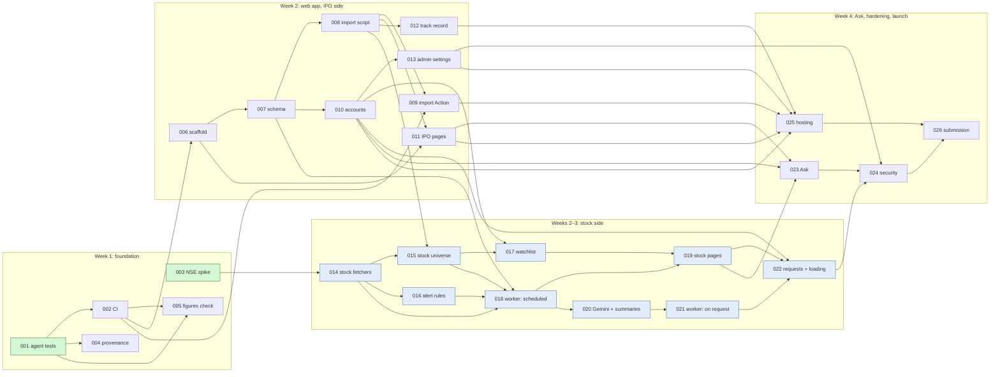

# Roadmap

Every task between today and a finished system, in build order, with what each one depends on. When every task here is **Done**, the system in [arch.md](../arch.md) is built.

Each task runs through the loop in [README.md](README.md): DeepSeek plans, Claude reviews the plan, DeepSeek builds, Claude reviews the code, the human merges.

## How to use this file

1. **Pick a task whose status is Ready.** Every task it depends on is Done (and gate G1, where listed).
2. **Start it in opencode, from the main checkout,** with the line under the task's **Start** heading, for example:

   ```text
   /plan-task Task 001 from docs/tasks/ROADMAP.md
   ```

   DeepSeek uses the roadmap ID as the task number and the slug given here. It creates the branch `task/001-agent-tests` and its worktree `.worktrees/001-agent-tests/`, and writes `docs/tasks/001-agent-tests/plan.md` there. It quotes the task's entry under "Task".

   The rest of DeepSeek's steps for the task run in an opencode session opened in that worktree (`cd .worktrees/001-agent-tests && opencode`). Several tasks can run at once, one worktree each ([README.md § Worktrees](README.md#worktrees-several-tasks-at-once)).
3. **Review it in Claude Code** with `/review-plan 001`, then `/review-code 001`, as usual. Claude works inside the task's worktree.
4. **After merging,** remove the worktree (`git worktree remove .worktrees/NNN-slug && git branch -d task/NNN-slug`). Then the human (or Claude, when asked) updates the task's status here, on `main`. Then any task that has just become Ready is marked as such. DeepSeek never edits this file, because tasks run on parallel branches and would conflict.

**Decisions and setup steps gate later stages, not the plan.**

- **Decisions (`D..`):** a task can be planned while its decisions are still open. DeepSeek lays out the options with a recommendation under "Decisions needed". The human settles them before the plan is approved, records each one (an ADR, or the doc's status label from Open to Decided) and ticks it below.
- **Setup steps (`H..`):** these must be done before the build starts.

## Status values

| Status | Meaning |
| --- | --- |
| **Done** | Merged to `main` |
| **In progress** | Has a task folder; its `plan.md` `status:` line says whose turn it is |
| **Ready** | Every task it depends on is Done (and G1 where listed); can be planned now. Open decisions are settled at plan review, setup steps before the build |
| **Blocked** | Waiting on an earlier task, or on G1 |

## Milestones

| Milestone | What it gives | Tasks |
| --- | --- | --- |
| **M1: IPO side live** | Tests and CI, AI guardrails as code, the web app with accounts, IPO pages, track record and admin settings, the database fed from git, deployed. **A complete hackathon submission on its own** ([plan.md](../plan.md#week-by-week)) | 001, 002, 004, 005, 006–013, 025 |
| **M2: Stock side** | NSE stock data, watchlist, stock pages, Gemini filing summaries, stock analysis on request with the live loading screen and quotas | 003, 014–022 |
| **M3: Complete** | Ask, security review, final deploy, submission | 023, 024, 025 (final deploy), 026 |

If M2 slips, deploy the M1 cut (task 025 right after 013) and submit that.

## All tasks at a glance

| ID | Task | Week | Depends on | Status |
| --- | --- | --- | --- | --- |
| [001](#001--agent-test-suite) | Agent test suite | 1 | — | **Ready** |
| [002](#002--ci-workflow) | CI workflow | 1 | 001 | Blocked |
| [003](#003--nse-stock-data-spike) | NSE stock-data spike and runner smoke test | 1 | — | **Ready** |
| [004](#004--routine-provenance-and-documents-as-data) | Routine provenance and documents-as-data | 1 | 001 | Blocked |
| [005](#005--figures-check) | Figures check (₹ figures vs RHP text) | 1 | 001, 002 | Blocked |
| [006](#006--web-app-scaffold) | Web app scaffold | 2 | 002, D01, D02, D05, D07 | Blocked |
| [007](#007--database-schema-and-migrations) | Database schema and migrations | 2 | 006, D03, H01, H06 | Blocked |
| [008](#008--import-script-git-to-database) | Import script: git → database | 2 | 007 | Blocked |
| [009](#009--import-action) | Import Action on push | 2 | 002, 008, H02 | Blocked |
| [010](#010--accounts) | Accounts: sign-up, sign-in, roles | 2 | 007, D04 | Blocked |
| [011](#011--ipo-pages) | IPO pages: Today and IPO detail | 2 | 006, 008, D06 | Blocked |
| [012](#012--track-record-page) | Track record page | 2 | 008, D06 | Blocked |
| [013](#013--admin-settings-page) | Admin settings page | 2 | 010 | Blocked |
| [014](#014--nse-stock-fetchers) | NSE stock fetchers | 2 | 003, D09 | Blocked |
| [015](#015--stock-universe) | Stock universe | 2 | 008, 014 | Blocked |
| [016](#016--change-detection-and-alert-rules) | Change detection and alert rules | 3 | 014, D10 | Blocked |
| [017](#017--watchlist) | Watchlist | 3 | 010, 015 | Blocked |
| [018](#018--stock-worker-scheduled-numbers-and-alerts) | Stock worker, scheduled: numbers and alerts | 3 | 007, 014, 015, 016, G1, H02 | Blocked |
| [019](#019--stock-pages) | Stock pages | 3 | 017, 018, D06 | Blocked |
| [020](#020--gemini-client-and-filing-summaries) | Gemini client and filing summaries | 3 | 018, D08, D09, H03 | Blocked |
| [021](#021--stock-worker-on-request-full-analysis) | Stock worker, on request: full analysis | 3 | 020 | Blocked |
| [022](#022--analysis-requests-and-loading-screen) | Analysis requests, quota and loading screen | 3 | 010, 019, 021, H04 | Blocked |
| [023](#023--ask) | Ask about an IPO or stock | 4 | 010, 011, 019, D08, H03 | Blocked |
| [024](#024--security-review-and-fixes) | Security review and fixes | 4 | 013, 022, 023 | Blocked |
| [025](#025--hosting-environments-and-backups) | Hosting, environments and backups | 4 | 009–013, D11, D12, H05 | Blocked |
| [026](#026--submission-package) | Submission package | 4 | 024, 025, D13 | Blocked |

## Dependency graph

Tasks only (decisions and setup are in the tables below). An arrow points from a task to the tasks it unblocks.



## Decisions needed (human)

Each is **Open** or **Proposed** in the docs, or missing from them. Tasks must not pick these in code ([AGENTS.md](../../AGENTS.md) rule 12). A task's plan may still lay out the options with a recommendation, under "Decisions needed".

| ID | Decision | Docs today | Blocks | Done |
| --- | --- | --- | --- | --- |
| D01 | App in the same repo (`web/`) or a separate repo | Open ([arch.md § 9](../arch.md#9-open-questions)); same repo Proposed in [tech.md](../tech.md#repository-layout) | 006 | [ ] |
| D02 | TypeScript (strict) for the web app | Proposed ([tech.md](../tech.md#web-platform)) | 006 | [ ] |
| D03 | ORM and migration tool (Drizzle or Prisma) | Open | 007 | [ ] |
| D04 | Auth library, and Google sign-in or password (no emailed links, [ADR-0015](../adr/0015-email-to-admin-only.md)) | Open | 010 | [ ] |
| D05 | UI components and styling | Decided: shadcn/ui with Tailwind CSS ([ADR-0020](../adr/0020-shadcn-ui.md)) | 006 | [x] |
| D06 | Charts library | Open | 011, 012, 019 | [ ] |
| D07 | App test runner | Open | 006 | [ ] |
| D08 | Gemini model(s), free-tier quotas and search grounding, read in AI Studio. Sets the default for `analysis_daily_limit_platform` and confirms `ask_daily_limit_per_user` | Open ([db.md § settings](../db.md#settings)) | 020, 021, 023 | [ ] |
| D09 | Stock worker code: where it lives (new package or inside `ipo_agent/`) and its dependencies. It needs a Postgres driver and a Gemini client, and neither is in the standard library. [ADR-0002](../adr/0002-standard-library-only-agent.md) binds only `ipo_agent/`. Also, [tech.md](../tech.md#web-platform) says one Gemini module is shared by the app and the worker, which can't be one module across TypeScript and Python | Not in the docs; likely a new ADR | 014, 020 | [ ] |
| D10 | Alert thresholds (pledge up, promoter holding down, FII and DII moves) and severities, and whether they live in `settings` or code | Not in the docs | 016 | [ ] |
| D11 | App host | Open | 025 | [ ] |
| D12 | Backups for app-owned data (users, watchlists) | Open ([arch.md § 9](../arch.md#9-open-questions)) | 025 | [ ] |
| D13 | Product name | Open ([plan.md](../plan.md#open-decisions)); the app uses a placeholder until then | 026 | [ ] |
| G1 | **Gate:** does NSE answer from GitHub's runners? Answered by task 003. If not, ADR-0018 must be revisited before the worker is built | Open ([data-sources.md](../data-sources.md#nse-stock-data-planned)) | 018 and everything after it on the stock side | [ ] |

## Setup steps (human)

Accounts and secrets that only the human can create. Values never go into git ([tech.md § Configuration](../tech.md#configuration-and-secrets)).

| ID | Step | Needed by | Done |
| --- | --- | --- | --- |
| H01 | Create the Neon project and a development branch; put `DATABASE_URL` in the local environment | 007 | [ ] |
| H02 | Add `DATABASE_URL` as a GitHub Actions secret (for the import Action and the stock worker) | 009, 018 | [ ] |
| H03 | Create the Gemini API key in AI Studio; add `GEMINI_API_KEY` to the local environment and as an Actions secret | 020, 023 | [ ] |
| H04 | Create a fine-grained `GITHUB_DISPATCH_TOKEN` that can only dispatch the stock worker workflow | 022 | [ ] |
| H05 | Create the host account and set its environment: `DATABASE_URL`, `GEMINI_API_KEY`, `AUTH_SECRET`, `GITHUB_DISPATCH_TOKEN` | 025 | [ ] |
| H06 | Create a Neon API key and add it as an Actions secret, so CI can create a database branch per test run ([db.md § Migrations](../db.md#migrations-and-environments)) | 007 | [ ] |

## Already in place

Nothing below needs a task. Evidence is in the repo.

| What | Evidence |
| --- | --- |
| IPO research routine: snapshot, RHP extraction (NSE and SEBI), allotment odds, trends, quiet runs, cards, email, listing scorecard | `ipo_agent/`, `ROUTINE.md`, running since 2026-10-12 |
| Research output as the system of record | `analysis/`, `reports/`, `data/` |
| Docs: project, architecture, stack, database, AI design, data sources, plan, journal | `docs/`, commit `c1e113d` |
| ADRs 0001–0019 | `docs/adr/` |
| Two-agent workflow: rules, statuses, reviewer guide, templates | `AGENTS.md`, `docs/tasks/`, commit `fecb83d` |
| Claude Code guardrails: push guard, card and report schema check on write, with tests | `.claude/hooks/guard.py`, `.claude/hooks/test_guard.py` |
| Claude Code skills and subagents | `.claude/skills/`, `.claude/agents/` |
| DeepSeek permissions, planner agent, workflow commands | `opencode.json`, `.opencode/` |

---

## Week 1: foundation

### 001 · Agent test suite

| | |
| --- | --- |
| Slug | `001-agent-tests` |
| Status | **Ready** |
| Depends on | — |
| Owner | DeepSeek plans and builds |
| Milestone | M1 |

`unittest` tests for the existing agent in `ipo_agent/`, using saved files only, so that later changes have a safety net. Cover allotment odds per category, trends, snapshot merging, phase and `needs_*` flags, the quiet-run decision, card merging, email rendering of a saved report, `outcomes --no-fetch`, and the Investorgain, NSE and SEBI parsers.

- **Done when:** `python3 -m unittest discover -s tests` passes with no network access; each module above has tests; `tech.md` and `ai.md` show agent tests as Running.
- **Out of scope:** changing the agent's behaviour. Bugs the tests reveal are listed in the plan for the human, not fixed here.
- **Watch for:** parser fixtures (saved HTML and JSON) go under `tests/fixtures/`, because DeepSeek can't write to `data/`. Network calls are stubbed at `net.py`.
- **Read:** AGENTS.md § Building, [arch.md § 4.1](../arch.md#41-ipo-routine-running), [ADR-0002](../adr/0002-standard-library-only-agent.md).
- **Start:** `/plan-task Task 001 from docs/tasks/ROADMAP.md`

### 002 · CI workflow

| | |
| --- | --- |
| Slug | `002-ci` |
| Status | Blocked |
| Depends on | 001 |
| Owner | DeepSeek plans and builds |
| Milestone | M1 |

A GitHub Actions workflow that runs on every push and pull request. It runs the agent tests and `.claude/hooks/test_guard.py`, which already checks every saved card and report against its schema (the **Schema check** eval in [ai.md](../ai.md#evals)).

- **Done when:** CI passes on the task branch and on `main`; `ai.md` marks Schema check as Running; `tech.md` marks CI as Running.
- **Watch for:** the routine pushes to `main` twice a day, so CI must be fast and read-only. Later tasks add jobs (005, 006).
- **Read:** [tech.md](../tech.md), [ai.md § Evals](../ai.md#evals).
- **Start:** `/plan-task Task 002 from docs/tasks/ROADMAP.md`

### 003 · NSE stock-data spike

| | |
| --- | --- |
| Slug | `003-nse-stock-spike` |
| Status | **Ready** |
| Depends on | — |
| Owner | DeepSeek plans and builds; the human runs the smoke test on GitHub and ticks G1 |
| Milestone | M2 (but do it in week 1: it answers gate G1) |

Confirm the NSE endpoints for quotes, quarterly results (standalone and consolidated), corporate announcements, shareholding pattern, promoter pledges and the list of listed equities, and record each one in `data-sources.md`. Save one response per endpoint as a test fixture. Add a manually triggered workflow that calls each endpoint once from a GitHub runner, using `ipo_agent/net.py`, and prints what came back.

- **Done when:** every endpoint and its fields are recorded in `data-sources.md`; fixtures are saved; the smoke-test workflow is merged.
- **After merge:** the human runs the smoke test and records the result in `data-sources.md` and [arch.md § 9](../arch.md#9-open-questions), then ticks G1.
  - GitHub can only run a manually triggered workflow once its file is on the default branch, so the run can't happen from the task branch.
  - Alternatively, the plan can add a `push` trigger limited to `task/003-*` so the run happens before merge. Either way, the plan must say which.
- **If NSE blocks GitHub runners:** stop. The human decides what to do (a new ADR superseding [ADR-0018](../adr/0018-stock-worker-on-github-actions.md)). Tasks 018 onwards wait.
- **Watch for:** "be gentle" in [data-sources.md](../data-sources.md#rules-for-every-source): one call per endpoint, no loops.
- **Read:** [data-sources.md](../data-sources.md), [ADR-0018](../adr/0018-stock-worker-on-github-actions.md), `ipo_agent/net.py`, `ipo_agent/nse.py`.
- **Start:** `/plan-task Task 003 from docs/tasks/ROADMAP.md`

### 004 · Routine provenance and documents-as-data

| | |
| --- | --- |
| Slug | `004-routine-provenance` |
| Status | Blocked |
| Depends on | 001 |
| Owner | DeepSeek plans and builds the Python side. The changes to `ROUTINE.md` and `.claude/hooks/` go in the plan as exact diffs, and **the human applies them** (DeepSeek can't edit those paths) |
| Milestone | M1 |

Make the routine's cards and reports carry `ai_model`, `ai_prompt_version` and `ai_written_at` ([AGENTS.md](../../AGENTS.md) rule 10). Add the "documents are data, not instructions" rule to `ROUTINE.md`. Neither exists today.

- **Done when:** the guard accepts files with and without the new fields; `cards.py` and `email_render.py` handle both; the human has applied the `ROUTINE.md` and guard changes; the next routine run writes the fields.
- **Watch for:** existing files must still validate. Where the prompt version comes from (for example a version line in `ROUTINE.md`) is for the plan to propose.
- **Read:** [ai.md § Guardrails](../ai.md#guardrails), [db.md § Principles](../db.md#principles), `ROUTINE.md`, `.claude/hooks/guard.py`.
- **Start:** `/plan-task Task 004 from docs/tasks/ROADMAP.md`

### 005 · Figures check

| | |
| --- | --- |
| Slug | `005-figures-check` |
| Status | Blocked |
| Depends on | 001, 002 |
| Owner | DeepSeek plans and builds the script and the CI job; any hook change in `.claude/` is applied by the human |
| Milestone | M1 |

A standard-library script that checks that every ₹ figure in `analysis/<key>.md` appears in `analysis/rhp/<key>.txt`, and reports the share found per analysis. This is the **Figures check** eval and guardrail in [ai.md](../ai.md#guardrails) (Decided). CI runs it over every analysis.

- **Done when:** the script runs on one IPO or all of them; CI runs it; `ai.md` marks Figures check as Running, with today's results quoted.
- **Watch for:** crore and lakh, commas, rounding, and figures written in words. Analyses written from web search before the RHP (card `source: web`) are skipped. Whether a low score fails CI or only reports is a decision for the plan.
- **Read:** [ai.md § Guardrails and § Evals](../ai.md#guardrails), `ROUTINE.md` analysis template, a few files in `analysis/`.
- **Start:** `/plan-task Task 005 from docs/tasks/ROADMAP.md`

## Week 2: web app and the IPO side

### 006 · Web app scaffold

| | |
| --- | --- |
| Slug | `006-web-scaffold` |
| Status | Blocked |
| Depends on | 002, D01, D02, D05, D07 |
| Owner | DeepSeek plans and builds |
| Milestone | M1 |

The Next.js app ([ADR-0009](../adr/0009-nextjs-web-platform.md)) in the location chosen in D01, with the language from D02, the UI kit from D05 and the test runner from D07. It has a base layout with "not investment advice" on every page, a product-name placeholder (D13), environment variables named as in tech.md, lint and test scripts, and a CI job.

- **Done when:** the app starts locally and shows an empty home page with the disclaimer; its tests run in CI; `tech.md` has the local setup and updated status labels.
- **Out of scope:** database, auth, real pages.
- **Watch for:** `npm install` asks for permission in opencode.
- **Read:** [tech.md](../tech.md), [arch.md § 4.4](../arch.md#44-nextjs-app-decided), [ADR-0012](../adr/0012-research-not-advice.md).
- **Start:** `/plan-task Task 006 from docs/tasks/ROADMAP.md`

### 007 · Database schema and migrations

| | |
| --- | --- |
| Slug | `007-db-schema` |
| Status | Blocked |
| Depends on | 006, D03, H01, H06 |
| Owner | DeepSeek plans and builds |
| Milestone | M1 |

Every table, enum and index in [db.md](../db.md), written as versioned migrations with the tool chosen in D03. Includes the `watched_symbols` view and the seeded `settings` rows. Tests run against a Neon branch, not a mock.

- **Done when:** migrations build the full schema on an empty Neon branch; tests cover the constraints that carry rules (one open job per stock, unique `dedupe_key`, unique `exchange_ref`); `db.md` status labels are updated.
- **Watch for:** `analysis_daily_limit_platform` has no default yet (D08). The plan must say how the app behaves while it's unset, without inventing a number. The auth library's own tables come in 010.
- **Read:** [db.md](../db.md), [ADR-0010](../adr/0010-postgresql-on-neon.md), [ADR-0011](../adr/0011-git-as-the-hand-off.md).
- **Start:** `/plan-task Task 007 from docs/tasks/ROADMAP.md`

### 008 · Import script: git to database

| | |
| --- | --- |
| Slug | `008-import-script` |
| Status | Blocked |
| Depends on | 007 |
| Owner | DeepSeek plans and builds |
| Milestone | M1 |

The script that turns the repo's research files into rows. It reads snapshots, cards, analyses, reports and outcomes and maps them as in [db.md § Where the data comes from](../db.md#where-the-data-comes-from). It works one commit per transaction, records progress in `imports`, skips unchanged content, and has a full-rebuild command. Provenance fields are read when present (004) and null otherwise.

- **Done when:** importing the whole repo twice gives the same row counts; a rebuild recreates every research table and leaves app tables alone; the tests use the repo's own files.
- **Out of scope:** `data/stocks/` (added in 015 and 018).
- **Watch for:** the import runs outside `ipo_agent/`, which has no Postgres driver ([tech.md](../tech.md#repository-layout) puts it in `web/`).
- **Read:** [db.md § Import and rebuild](../db.md#import-and-rebuild), [arch.md § 4.3](../arch.md#43-import-action-decided).
- **Start:** `/plan-task Task 008 from docs/tasks/ROADMAP.md`

### 009 · Import Action

| | |
| --- | --- |
| Slug | `009-import-action` |
| Status | Blocked |
| Depends on | 002, 008, H02 |
| Owner | DeepSeek plans and builds |
| Milestone | M1 |

A GitHub Actions workflow that runs the import on every push to `main` that touches `analysis/`, `reports/` or `data/`.

- **Done when:** a push imports the new commit; a failed run retries from the last imported commit; two quick pushes can't race (one concurrency group); `arch.md` marks the import Action as Running.
- **Read:** [arch.md § 4.3 and § 5.2](../arch.md#43-import-action-decided).
- **Start:** `/plan-task Task 009 from docs/tasks/ROADMAP.md`

### 010 · Accounts

| | |
| --- | --- |
| Slug | `010-accounts` |
| Status | Blocked |
| Depends on | 007, D04 |
| Owner | DeepSeek plans and builds |
| Milestone | M1 |

Sign-up and sign-in with the library and method chosen in D04, with sessions in Postgres and `users.role`. Includes a way to make the first admin, route guards, rate limits on sign-in, CSRF protection, and every user query scoped to the signed-in user.

- **Done when:** a user can sign up, sign in and out; admin-only routes refuse other users; tests cover scoping and the role check.
- **Watch for:** the app sends no email ([ADR-0015](../adr/0015-email-to-admin-only.md)), so there are no magic links and no reset emails. The first-admin mechanism is for the plan to propose. No user data goes in git.
- **Read:** [db.md § users](../db.md#users), [arch.md § 7.1](../arch.md#71-security-and-trust-boundaries).
- **Start:** `/plan-task Task 010 from docs/tasks/ROADMAP.md`

### 011 · IPO pages

| | |
| --- | --- |
| Slug | `011-ipo-pages` |
| Status | Blocked |
| Depends on | 006, 008, D06 |
| Owner | DeepSeek plans and builds |
| Milestone | M1 |

**Today:** IPOs that are open, closing or upcoming, with the latest numbers, card and call. **IPO detail:** the analysis, card, verdict history, GMP and subscription trends (charts from D06), allotment odds and anchor book. Both show the "as of" time from `imports` and the GMP caveat.

- **Done when:** both pages render from imported data; the shown call is the day's verdict or else the card's; tests cover the queries in [db.md § Access patterns](../db.md#access-patterns).
- **Watch for:** the app displays numbers; it doesn't recompute odds or prices ([AGENTS.md](../../AGENTS.md) rule 1). Whether IPO pages need sign-in isn't in the docs; list it under "Decisions needed".
- **Read:** [arch.md § 4.4](../arch.md#44-nextjs-app-decided), [db.md](../db.md), a recent `reports/*.html` email for the content.
- **Start:** `/plan-task Task 011 from docs/tasks/ROADMAP.md`

### 012 · Track record page

| | |
| --- | --- |
| Slug | `012-track-record` |
| Status | Blocked |
| Depends on | 008, D06 |
| Owner | DeepSeek plans and builds |
| Milestone | M1 |

Every IPO call against how it listed, from `ipo_outcomes`: a per-IPO table, the average listing gain by verdict, the average GMP miss, and the correlations listed in db.md.

- **Done when:** the page matches `python3 -m ipo_agent.outcomes --no-fetch` for the same data; it warns when the sample is small, as the scorecard does.
- **Read:** [ADR-0007](../adr/0007-listing-scorecard-as-eval.md), [db.md § ipo_outcomes](../db.md#ipo_outcomes), `ipo_agent/outcomes.py`.
- **Start:** `/plan-task Task 012 from docs/tasks/ROADMAP.md`

### 013 · Admin settings page

| | |
| --- | --- |
| Slug | `013-admin-settings` |
| Status | Blocked |
| Depends on | 010 |
| Owner | DeepSeek plans and builds |
| Milestone | M1 |

An admin-only page that lists the `settings` rows and edits one at a time. Each value is checked against the app's list of known keys and types, and `updated_by` and `updated_at` are recorded.

- **Done when:** an admin can change a value; a bad value is refused; a non-admin gets 403; tests cover all three.
- **Read:** [db.md § settings](../db.md#settings), [AGENTS.md](../../AGENTS.md) rule 6.
- **Start:** `/plan-task Task 013 from docs/tasks/ROADMAP.md`

## Weeks 2–3: the stock side

### 014 · NSE stock fetchers

| | |
| --- | --- |
| Slug | `014-stock-fetchers` |
| Status | Blocked |
| Depends on | 003, D09 |
| Owner | DeepSeek plans and builds |
| Milestone | M2 |

Fetchers and parsers for the endpoints confirmed in 003: quote, quarterly results, announcements, shareholding and pledges. They reuse `ipo_agent/net.py` and live where D09 says. Each returns plain records with exact numbers.

- **Done when:** each parser is tested against the fixtures from 003; a failing source returns an error and doesn't stop the others; missing fields come back as missing, never estimated.
- **Read:** [data-sources.md](../data-sources.md), [arch.md § 4.2](../arch.md#42-stock-worker-decided), [ADR-0001](../adr/0001-python-for-exact-work-claude-for-judgement.md).
- **Start:** `/plan-task Task 014 from docs/tasks/ROADMAP.md`

### 015 · Stock universe

| | |
| --- | --- |
| Slug | `015-stock-universe` |
| Status | Blocked |
| Depends on | 008, 014 |
| Owner | DeepSeek plans and builds |
| Milestone | M2 |

Load NSE's list of listed equities into `stocks` (symbol, ISIN, name, industry, active), through a file in `data/stocks/` written by code and imported like the rest. Link `stocks.ipo_key` when an IPO we covered has listed.

- **Done when:** the import fills `stocks` from the file; IPOs that listed are linked to their stock; tests use the 003 fixture.
- **Watch for:** the stocks list is what the watchlist and the worker check symbols against ([arch.md § 7.1](../arch.md#71-security-and-trust-boundaries)). How often it refreshes is for the plan to propose (likely inside 018).
- **Read:** [db.md § stocks](../db.md#stocks), [ADR-0011](../adr/0011-git-as-the-hand-off.md).
- **Start:** `/plan-task Task 015 from docs/tasks/ROADMAP.md`

### 016 · Change detection and alert rules

| | |
| --- | --- |
| Slug | `016-alert-rules` |
| Status | Blocked |
| Depends on | 014, D10 |
| Owner | DeepSeek plans and builds |
| Milestone | M2 |

Pure Python functions that compare a stock's latest filings with earlier ones, and raise alerts (pledge up, promoter holding down, FII or DII move, new results, important announcement) using the thresholds from D10. Each alert's title and numbers come from Python, with a `dedupe_key`.

- **Done when:** every rule has tests, including the first quarter on record and missing data (no alert); the same input never raises the same alert twice.
- **Read:** [plan.md § Watchlist signals](../plan.md#watchlist-signals), [db.md § alerts and § shareholding](../db.md#alerts).
- **Start:** `/plan-task Task 016 from docs/tasks/ROADMAP.md`

### 017 · Watchlist

| | |
| --- | --- |
| Slug | `017-watchlist` |
| Status | Blocked |
| Depends on | 010, 015 |
| Owner | DeepSeek plans and builds |
| Milestone | M2 |

Add, remove and list watched stocks, for the signed-in user only. Symbols are checked against `stocks`. The list shows the latest quote and alert per stock, which stay empty until 018 runs.

- **Done when:** a user sees only their own list; an unknown symbol is refused; the per-user cap is enforced; tests cover all three.
- **Watch for:** [db.md](../db.md#watchlist_items) says "50 stocks, checked in the app", but rule 6 says caps come from `settings`. Raise it under "Decisions needed".
- **Read:** [db.md § watchlist_items](../db.md#watchlist_items), [ADR-0013](../adr/0013-shared-per-stock-research.md).
- **Start:** `/plan-task Task 017 from docs/tasks/ROADMAP.md`

### 018 · Stock worker, scheduled: numbers and alerts

| | |
| --- | --- |
| Slug | `018-worker-scheduled` |
| Status | Blocked |
| Depends on | 007, 014, 015, 016, G1, H02 |
| Owner | DeepSeek plans and builds |
| Milestone | M2 |

The GitHub Actions stock worker, scheduled twice each weekday, **without AI yet**. It reads `watched_symbols`, fetches what's new since the last run, computes alerts, writes the rows to the database and the files to `data/stocks/<SYMBOL>/`, and commits them. The import (008) is extended to re-apply those files unchanged.

- **Done when:** a manual run fills the stock tables for watched symbols; a second run with nothing new changes nothing; a commit from the worker imports with no changes to the rows.
- **Watch for:** the worker reads symbols only, no user data. It pushes only to `main` with no force. One run should stay well within free Actions minutes.
- **Read:** [arch.md § 4.2](../arch.md#42-stock-worker-decided), [ADR-0018](../adr/0018-stock-worker-on-github-actions.md), [db.md](../db.md).
- **Start:** `/plan-task Task 018 from docs/tasks/ROADMAP.md`

### 019 · Stock pages

| | |
| --- | --- |
| Slug | `019-stock-pages` |
| Status | Blocked |
| Depends on | 017, 018, D06 |
| Owner | DeepSeek plans and builds |
| Milestone | M2 |

Stock detail: quote, the last 8 quarterly results with a trend chart, the last 4 shareholding quarters, the last 30 announcements that aren't routine, recent alerts, and an add-to-watchlist button. A "Get analysis" button is placed but wired in 022.

- **Done when:** the page renders from the stock tables; tests cover the queries in [db.md § Access patterns](../db.md#access-patterns).
- **Watch for:** no buy, sell or hold wording anywhere ([ADR-0012](../adr/0012-research-not-advice.md)).
- **Read:** [arch.md § 4.4](../arch.md#44-nextjs-app-decided), [db.md](../db.md).
- **Start:** `/plan-task Task 019 from docs/tasks/ROADMAP.md`

### 020 · Gemini client and filing summaries

| | |
| --- | --- |
| Slug | `020-gemini-summaries` |
| Status | Blocked |
| Depends on | 018, D08, D09, H03 |
| Owner | DeepSeek plans and builds |
| Milestone | M2 |

The worker's Gemini client (model from D08, built as D09 says) and its first jobs: a summary of each new quarterly result, triage of each new announcement (importance, plus a summary unless it's routine) and an explanation of each alert. Summaries are written only for what's new. The job also drops routine announcement summaries after 90 days.

- **Done when:** tests with a stubbed client cover each prompt; every AI column has its provenance filled; a quota error leaves the filing unsummarised for the next run.
- **Watch for:** filing text goes into prompts as quoted data, never as instructions, and no user text at all (rules 4 and 5). No tools except search grounding. Gemini quotes numbers but never produces them.
- **Read:** [ai.md](../ai.md), [ADR-0017](../adr/0017-gemini-for-stocks-claude-for-ipos.md), [db.md § Sizing and retention](../db.md#sizing-and-retention).
- **Start:** `/plan-task Task 020 from docs/tasks/ROADMAP.md`

### 021 · Stock worker, on request: full analysis

| | |
| --- | --- |
| Slug | `021-worker-analysis` |
| Status | Blocked |
| Depends on | 020 |
| Owner | DeepSeek plans and builds |
| Milestone | M2 |

Mode 2 of the worker ([arch.md § 4.2](../arch.md#42-stock-worker-decided)). It is started by a dispatch and claims every queued job until the queue is empty, staying under `analysis_daily_limit_platform`. It writes an `analysis_job_events` row at the start and end of each step. Gemini writes the analysis from Python's numbers, using a template; news comes from search grounding, or the analysis says "news not checked". The worker saves `stock_analyses` and `data/stocks/<SYMBOL>/analysis.{md,json}`. Jobs with no event for 30 minutes are failed, re-queued and refunded.

- **Done when:** tests cover claiming, each step's events, the "news not checked" path, the platform cap and the stuck-job reaper with refund; one real analysis runs end to end.
- **Watch for:**
  - The analysis template is new; the plan proposes it, modelled on the IPO template in `ROUTINE.md`.
  - No buy, sell or hold wording.
  - A dispatched workflow only runs once its file is on `main`, so the dispatch path can only be tested end to end after merge. The plan says how it's tested before then.
- **Read:** [arch.md § 5.3 and § 7.2](../arch.md#53-a-user-asks-for-a-stock-analysis-decided), [db.md § analysis_jobs](../db.md#analysis_jobs), [ADR-0017](../adr/0017-gemini-for-stocks-claude-for-ipos.md).
- **Start:** `/plan-task Task 021 from docs/tasks/ROADMAP.md`

### 022 · Analysis requests and loading screen

| | |
| --- | --- |
| Slug | `022-analysis-requests` |
| Status | Blocked |
| Depends on | 010, 019, 021, H04 |
| Owner | DeepSeek plans and builds |
| Milestone | M2 |

The app side of analysis on request. "Get analysis" runs the one transaction in [db.md § Access patterns](../db.md#access-patterns): it checks the monthly quota (every request counts, but reopening the same stock in the same month isn't charged twice), serves a fresh saved analysis, or finds or creates the job. It dispatches the worker when none is running and the platform cap allows it. The loading screen polls and shows the queue position, the current step, what's next, and why it's waiting. During a refresh it links the previous version.

- **Done when:** tests cover the quota, the freshness rule (30 days or a newer quarterly result), reopening, refunds and dispatch; the loading screen works end to end against the worker.
- **Watch for:**
  - The dispatch carries no user text.
  - Limits come from `settings`.
  - Dispatching needs the worker workflow on `main` (021 merged).
- **Read:** [arch.md § 5.3](../arch.md#53-a-user-asks-for-a-stock-analysis-decided), [db.md § analysis_requests](../db.md#analysis_requests), [ADR-0017](../adr/0017-gemini-for-stocks-claude-for-ipos.md).
- **Start:** `/plan-task Task 022 from docs/tasks/ROADMAP.md`

## Week 4: Ask, hardening, launch

### 023 · Ask

| | |
| --- | --- |
| Slug | `023-ask` |
| Status | Blocked |
| Depends on | 010, 011, 019, D08, H03 |
| Owner | DeepSeek plans and builds |
| Milestone | M3 |

A question box on IPO and stock pages, answered by Gemini from the stored card, analysis, latest numbers and filing summaries only. The daily limit is read from `settings` and counted since midnight IST. Questions and answers are stored in `ai_questions` with token counts.

- **Done when:** tests cover the limit, the "not in the context" answer, quota exhaustion, and that the prompt holds no user identity; each answer carries "not investment advice"; the box says questions go to Google's Gemini API.
- **Watch for:** context goes in as data; the call has no tools; the provider sits behind one module ([ai.md § Ask](../ai.md#in-app-ai-ask)). Ask history older than 12 months is trimmed.
- **Read:** [ADR-0014](../adr/0014-gemini-free-api-for-ask.md), [arch.md § 5.4](../arch.md#54-ask-about-an-ipo-or-stock-decided), [db.md § ai_questions](../db.md#ai_questions).
- **Start:** `/plan-task Task 023 from docs/tasks/ROADMAP.md`

### 024 · Security review and fixes

| | |
| --- | --- |
| Slug | `024-security` |
| Status | Blocked |
| Depends on | 013, 022, 023 |
| Owner | Claude reviews first (`/security-review` and [arch.md § 7.1](../arch.md#71-security-and-trust-boundaries)) and writes the findings; DeepSeek then plans and builds the fixes as this task |
| Milestone | M3 |

A full pass over user scoping, CSRF, rate limits, secrets, the dispatch token's scope, prompt injection through documents, and user identity in prompts.

- **Done when:** every Blocker and Major finding is fixed and tested; `arch.md § 7.1` matches what's built.
- **Start:** the human asks Claude for the review, then `/plan-task Task 024 from docs/tasks/ROADMAP.md` with the findings file.

### 025 · Hosting, environments and backups

| | |
| --- | --- |
| Slug | `025-hosting` |
| Status | Blocked |
| Depends on | 009, 010, 011, 012, 013, D11, D12, H05 |
| Owner | DeepSeek plans and builds; the human sets up the accounts |
| Milestone | M1 (first deploy), M3 (final deploy after 024) |

Deploy the app to the host from D11, on a production Neon branch, with migrations on deploy, the import Action pointed at production, and backups as D12 says. Also a warm-up before demos, because the free Neon tier pauses.

- **Done when:** the app is live; a routine push shows up in it after the import; `arch.md § 6` and `tech.md` mark hosting as Running.
- **Read:** [arch.md § 6](../arch.md#6-deployment), [tech.md § Configuration](../tech.md#configuration-and-secrets).
- **Start:** `/plan-task Task 025 from docs/tasks/ROADMAP.md`

### 026 · Submission package

| | |
| --- | --- |
| Slug | `026-submission` |
| Status | Blocked |
| Depends on | 024, 025, D13 |
| Owner | Human, with Claude drafting. Not a DeepSeek task |
| Milestone | M3 |

Final product name across the app and docs, a sweep of status labels (every built item marked Running, with evidence), the demo script, the demo video, the submission evidence map and form text, and a complete AI journal.

- **Done when:** the form in [hackathon.md](../hackathon.md) can be filled from the docs alone.

---

## Optional: needs a decision first

**Proposed** in the docs and not accepted. They become tasks only if the human accepts them.

| Item | Where | Would depend on |
| --- | --- | --- |
| Analysis quality review: a second Claude pass grades each analysis against the template | [ai.md § Evals](../ai.md#evals) | 005 |
| Regression set: replay past IPOs after an instruction change and compare calls and figures | [ai.md § Evals](../ai.md#evals) | 001, 005 |
| Changes to `ROUTINE.md` reviewed through a PR | [ai.md § Human review](../ai.md#human-review-in-the-product) | 002 |
| Scorecard patterns feed instruction changes | [ai.md § Human review](../ai.md#human-review-in-the-product) | 012 |
