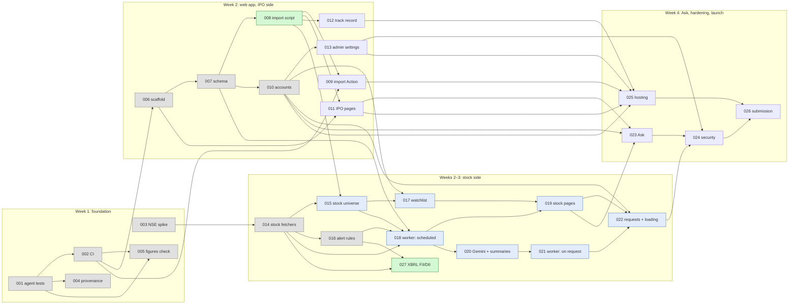

# Roadmap

Every task between today and a finished system, in build order, with what each one depends on. When every task here is **Done**, the system in [arch.md](../arch.md) is built.

Each task runs through the loop in [README.md](README.md): DeepSeek plans, Claude reviews the plan, DeepSeek builds, Claude reviews the code, the human merges. Claude Code runs DeepSeek's steps through OpenRouter ([ADR-0021](../adr/0021-deepseek-on-openrouter.md)).

## How to use this file

1. **Pick a task whose status is Ready.** Every task it depends on is Done (and gate G1, where listed).
2. **Ask Claude Code to run it, from the main checkout,** with the line under the task's **Start** heading, for example:

   ```text
   /run-task 005
   ```

   The driver uses the roadmap ID as the task number and the slug given here. It creates the branch `task/005-figures-check` and its worktree `.worktrees/005-figures-check/`, and quotes the task's entry under "Task" in `docs/tasks/005-figures-check/plan.md` there. DeepSeek writes the plan.

   Claude then runs the loop: its plan review, DeepSeek's revisions and build, its code review, DeepSeek's fixes. It stops when the human is needed: a decision, a setup step, a package to install, or `merge-ready`. Several tasks can run at once, one worktree each ([README.md § Worktrees](README.md#worktrees-several-tasks-at-once)).
3. **Answer Claude's questions** when it stops. `/review-plan NNN` and `/review-code NNN` still run a single review on their own.
4. **After merging,** remove the worktree (`git worktree remove .worktrees/NNN-slug && git branch -d task/NNN-slug`). Then the human (or Claude, when asked) updates the task's status here, on `main`. Then any task that has just become Ready is marked as such. DeepSeek never edits this file, because tasks run on parallel branches and would conflict.

**Keep this file current.** Any commit on `main` that changes something tracked here updates this file in the same commit: a task merged or its scope changed, a decision settled or an ADR added, a setup step done, a gate answered, or work landed outside a task (add it under "Already in place", and note it in any task it affects). A task's plan lists, under "Doc updates", the roadmap changes to make after it merges.

**Decisions and setup steps gate later stages, not the plan.**

- **Decisions (`D..`):** a task can be planned while its decisions are still open. DeepSeek lays out the options with a recommendation under "Decisions needed". The human settles them before the plan is approved, records each one (an ADR, or the doc's status label from Open to Decided) and ticks it below.
- **Setup steps (`H..`):** these must be done before the build starts.

## Status values

| Status | Meaning |
| --- | --- |
| **Done** | Merged to `main` |
| **In progress** | Has a task folder; its `plan.md` `status:` line says whose turn it is |
| **Ready** | Every task it depends on is Done (and G1 where listed); can be planned now. Open decisions are settled at plan review, setup steps before the build |
| **Blocked** | Waiting on an earlier task, or on G1 |

## Milestones

| Milestone | What it gives | Tasks |
| --- | --- | --- |
| **M1: IPO side live** | Tests and CI, AI guardrails as code, the web app with accounts, IPO pages, track record and admin settings, the database fed from git, deployed. **A complete hackathon submission on its own** ([plan.md](../plan.md#week-by-week)) | 001, 002, 004, 005, 006–013, 025 |
| **M2: Stock side** | NSE stock data, watchlist, stock pages, Gemini filing summaries, stock analysis on request with the live loading screen and quotas | 003, 014–022 |
| **M3: Complete** | Ask, security review, final deploy, submission | 023, 024, 025 (final deploy), 026 |

If M2 slips, deploy the M1 cut (task 025 right after 013) and submit that.

## All tasks at a glance

| ID | Task | Week | Depends on | Status |
| --- | --- | --- | --- | --- |
| [001](#001--agent-test-suite) | Agent test suite | 1 | — | Done |
| [002](#002--ci-workflow) | CI workflow | 1 | 001 | Done |
| [003](#003--nse-stock-data-spike) | NSE stock-data spike and runner smoke test | 1 | — | Done |
| [004](#004--routine-provenance-and-documents-as-data) | Routine provenance and documents-as-data | 1 | 001 | Done |
| [005](#005--figures-check) | Figures check (₹ figures vs RHP text) | 1 | 001, 002 | Done |
| [006](#006--web-app-scaffold) | Web app scaffold | 2 | 002, D01, D02, D05, D07 | Done |
| [007](#007--database-schema-and-migrations) | Database schema and migrations | 2 | 006, D03, H01, H06 | Done |
| [008](#008--import-script-git-to-database) | Import script: git → database | 2 | 007 | **Ready** |
| [009](#009--import-action) | Import Action on push | 2 | 002, 008, H02 | Blocked |
| [010](#010--accounts) | Accounts: invite-only sign-in, roles | 2 | 007, D04 | Done |
| [011](#011--ipo-pages) | IPO pages: Today and IPO detail | 2 | 006, 008, D06 | Blocked |
| [012](#012--track-record-page) | Track record page | 2 | 008, D06 | Blocked |
| [013](#013--admin-settings-page) | Admin settings page | 2 | 010 | **Ready** |
| [014](#014--nse-stock-fetchers) | NSE stock fetchers | 2 | 003, D09 | Done |
| [015](#015--stock-universe) | Stock universe | 2 | 008, 014 | Blocked |
| [016](#016--change-detection-and-alert-rules) | Change detection and alert rules | 3 | 014, D10 | Done |
| [017](#017--watchlist) | Watchlist | 3 | 010, 015 | Blocked |
| [018](#018--stock-worker-scheduled-numbers-and-alerts) | Stock worker, scheduled: numbers and alerts | 3 | 007, 014, 015, 016, G1, H02 | Blocked |
| [019](#019--stock-pages) | Stock pages | 3 | 017, 018, D06 | Blocked |
| [020](#020--gemini-client-and-filing-summaries) | Gemini client and filing summaries | 3 | 018, D08, D09, H03 | Blocked |
| [021](#021--stock-worker-on-request-full-analysis) | Stock worker, on request: full analysis | 3 | 020 | Blocked |
| [022](#022--analysis-requests-and-loading-screen) | Analysis requests, quota and loading screen | 3 | 010, 019, 021, H04 | Blocked |
| [023](#023--ask) | Ask about an IPO or stock | 4 | 010, 011, 019, D08, H03 | Blocked |
| [024](#024--security-review-and-fixes) | Security review and fixes | 4 | 013, 022, 023 | Blocked |
| [025](#025--hosting-environments-and-backups) | Hosting, environments and backups | 4 | 009–013, D11, D12, H05 | Blocked |
| [026](#026--submission-package) | Submission package | 4 | 024, 025, D13 | Blocked |
| [027](#027--xbrl-shareholding-parsing-fiidii) | XBRL shareholding parsing (FII/DII) | 3 | 014, 016 | **Ready** |

## Dependency graph

Tasks only (decisions and setup are in the tables below). An arrow points from a task to the tasks it unblocks.



## Decisions needed (human)

Each is **Open** or **Proposed** in the docs, or missing from them. Tasks must not pick these in code ([AGENTS.md](../../AGENTS.md) rule 12). A task's plan may still lay out the options with a recommendation, under "Decisions needed".

| ID | Decision | Docs today | Blocks | Done |
| --- | --- | --- | --- | --- |
| D01 | App in the same repo (`web/`) or a separate repo | Decided: same repo, `web/` ([ADR-0022](../adr/0022-web-app-in-same-repo.md)) | 006 | [x] |
| D02 | TypeScript (strict) for the web app | Decided: TypeScript, strict ([ADR-0023](../adr/0023-typescript-strict.md)) | 006 | [x] |
| D03 | ORM and migration tool (Drizzle or Prisma) | Decided: Drizzle with drizzle-kit, on Neon's serverless driver ([ADR-0025](../adr/0025-drizzle-on-neon-serverless-driver.md)) | 007 | [x] |
| D04 | Auth library, and Google sign-in or password | Decided by the human on 2026-10-30: Better Auth, email and password, no public sign-up; the admin invites users, and invite and password-reset links go out through Resend ([ADR-0028](../adr/0028-better-auth-invite-only.md), superseding ADR-0015 for those two emails) | 010 | [x] |
| D05 | UI components and styling | Decided: shadcn/ui with Tailwind CSS ([ADR-0020](../adr/0020-shadcn-ui.md)) | 006 | [x] |
| D06 | Charts library | Decided by the human on 2026-10-30: shadcn/ui's `chart` component on Recharts, added with `npx shadcn@latest add chart` by the first task that draws a chart ([ADR-0027](../adr/0027-shadcn-charts-on-recharts.md)) | 011, 012, 019 | [x] |
| D07 | App test runner | Decided: Vitest with React Testing Library ([ADR-0024](../adr/0024-vitest-for-app-tests.md)) | 006 | [x] |
| D08 | Gemini model(s), free-tier quotas and search grounding, read in AI Studio. Sets the default for `analysis_daily_limit_platform` and confirms `ask_daily_limit_per_user` | Open ([db.md § settings](../db.md#settings)). Task 007 seeded no row for the cap; while it's missing the gate is closed and no analysis is dispatched (human, 2026-10-30) | 020, 021, 023 | [ ] |
| D09 | Stock worker code: where it lives (new package or inside `ipo_agent/`) and its dependencies. It needs a Postgres driver and a Gemini client, and neither is in the standard library. [ADR-0002](../adr/0002-standard-library-only-agent.md) binds only `ipo_agent/`. Also, [tech.md](../tech.md#web-platform) says one Gemini module is shared by the app and the worker, which can't be one module across TypeScript and Python | Decided by the human at 014's plan review (2026-10-29): a new top-level package `stock_worker/`, importing `ipo_agent/net.py`; standard library in 014, later pinned packages through the package's own requirements file (Postgres driver in 018, Gemini SDK in 020); one Gemini module per side, TypeScript in `web/lib/` and Python in `stock_worker/`. Recorded in [ADR-0026](../adr/0026-stock-worker-code-location.md), accepted by the human on 2026-10-30 (option A) | 014, 020 | [x] |
| D10 | Alert thresholds (pledge up, promoter holding down, FII and DII moves) and severities, and whether they live in `settings` or code | Decided by the human at 016's plan review (2026-10-30): pledge up ≥ 1.00 pp, promoter holding down ≥ 2.00 pp, FII/DII move ≥ 1.00 pp either way, quarter on quarter; `results` → info, `announcement`/`fii_move`/`dii_move` → watch, `pledge_up`/`promoter_down` → warning; held in code (`stock_worker/alerts.py`), no `settings` rows. Recorded in [ADR-0029](../adr/0029-alert-thresholds-and-severities.md), accepted by the human on 2026-10-30 | 016 | [x] |
| D11 | App host | Open | 025 | [ ] |
| D12 | Backups for app-owned data (users, watchlists) | Open ([arch.md § 9](../arch.md#9-open-questions)) | 025 | [ ] |
| D13 | Product name | Open ([plan.md](../plan.md#open-decisions)); the app uses a placeholder until then | 026 | [ ] |
| G1 | **Gate:** does NSE answer from GitHub's runners? Answered by task 003. If not, ADR-0018 must be revisited before the worker is built | **Yes**, ticked by the human on 2026-10-29. Task 003's [run 40869763010](https://github.com/badjatya/IPO/actions/runs/40869763010) answered nine of ten data calls, the same as locally; the quote endpoint returns 403 everywhere and is left to 014 ([data-sources.md](../data-sources.md#nse-stock-data)) | 018 and everything after it on the stock side | [x] |

## Setup steps (human)

Accounts and secrets that only the human can create. Values never go into git ([tech.md § Configuration](../tech.md#configuration-and-secrets)).

| ID | Step | Needed by | Done |
| --- | --- | --- | --- |
| H01 | Create the Neon project and a development branch; put `DATABASE_URL` in the local environment. Done 2026-10-29: project `dark-field-33023581`, branches `production` (default) and `dev`; `neon checkout dev` in `web/` writes `web/.env.local` | 007 | [x] |
| H02 | Add `DATABASE_URL` as a GitHub Actions secret (for the import Action and the stock worker) | 009, 018 | [ ] |
| H03 | Create the Gemini API key in AI Studio; add `GEMINI_API_KEY` to the local environment and as an Actions secret | 020, 023 | [ ] |
| H04 | Create a fine-grained `GITHUB_DISPATCH_TOKEN` that can only dispatch the stock worker workflow | 022 | [ ] |
| H05 | Create the host account and set its environment: `DATABASE_URL`, `GEMINI_API_KEY`, `AUTH_SECRET`, `RESEND_API_KEY`, `EMAIL_FROM`, `GITHUB_DISPATCH_TOKEN` | 025 | [ ] |
| H06 | Create a Neon API key and add it as an Actions secret, so CI can create a database branch per test run ([db.md § Migrations](../db.md#migrations-and-environments)). Done 2026-10-29: key `github-actions-ci`, scoped to the project, in the `NEON_API_KEY` secret; `NEON_PROJECT_ID` is an Actions variable | 007 | [x] |
| H07 | Create a Resend account and API key, and verify a sending domain; put `RESEND_API_KEY` and `EMAIL_FROM` in `web/.env.local`. Until a domain is verified, Resend's test sender delivers only to the account owner's address. 010's tests don't need it (the mail module is replaced in tests); a real invite does. 010 is merged; its last done-when check, a real invite arriving, waits on this step. Account, key and `EMAIL_FROM` done 2026-10-30, with the `resend.dev` test sender: the project has no domain yet (human, 2026-10-30), so invites reach only the Resend account owner's address. Inviting anyone else needs a verified domain | 010 (manual check), 025 | [ ] |

## Already in place

Nothing below needs a task. Evidence is in the repo.

| What | Evidence |
| --- | --- |
| IPO research routine: snapshot, RHP extraction (NSE and SEBI), allotment odds, trends, quiet runs, cards, email, listing scorecard | `ipo_agent/`, `ROUTINE.md`, running since 2026-10-12 |
| Research output as the system of record | `analysis/`, `reports/`, `data/` |
| Docs: project, architecture, stack, database, AI design, data sources, plan, journal | `docs/`, commit `c1e113d` |
| UI design rules: component kit, theme, status colours, number formats, layout | `docs/design.md`, commit `33c5a73` |
| ADRs 0001–0029 | `docs/adr/` |
| Two-agent workflow: rules, statuses, reviewer guide, templates | `AGENTS.md`, `docs/tasks/`, commit `fecb83d` |
| Claude Code guardrails: push guard, card and report schema check on write, with tests | `.claude/hooks/guard.py`, `.claude/hooks/test_guard.py` |
| Claude Code skills and subagents | `.claude/skills/`, `.claude/agents/` |
| DeepSeek through OpenRouter: a driver with four steps (plan, revise, build, respond), file tools that keep to the write rules, a post-step check, and the `/run-task` loop. Replaced opencode on 2026-10-29 ([ADR-0021](../adr/0021-deepseek-on-openrouter.md)) | `.claude/deepseek/`, `.claude/skills/run-task/` |
| Web app scaffold: Next.js App Router, strict TypeScript, shadcn/ui on Tailwind CSS v4, disclaimer footer, Vitest tests, oxlint, a `web` CI job (task 006) | `web/`, commits `c835c42`, `33c5a73`, task 006 |
| Neon linked to the app: `web/neon.ts` branch policy (`dev` kept, other new branches expire in 7 days), the serverless driver in `web/lib/db.ts`, and a `GET /api/health/db` check. Done outside a task on 2026-10-29; task 007 builds on it ([ADR-0025](../adr/0025-drizzle-on-neon-serverless-driver.md)) | `web/neon.ts`, `web/lib/db.ts`, `web/app/api/health/db/route.ts` |
| Database schema: every db.md table, enum and index in Drizzle, checked-in migrations, the three decided `settings` rows, `db()` over the one Neon connection, and the Neon-branch tests in a CI `db` job (task 007) | `web/db/`, `web/scripts/neon-branch.mjs`, `web/tests/db/`, task 007 |

---

## Week 1: foundation

### 001 · Agent test suite

| | |
| --- | --- |
| Slug | `001-agent-tests` |
| Status | Done |
| Depends on | — |
| Owner | DeepSeek plans and builds |
| Milestone | M1 |

`unittest` tests for the existing agent in `ipo_agent/`, using saved files only, so that later changes have a safety net. Cover allotment odds per category, trends, snapshot merging, phase and `needs_*` flags, the quiet-run decision, card merging, email rendering of a saved report, `outcomes --no-fetch`, and the Investorgain, NSE and SEBI parsers.

- **Done when:** `python3 -m unittest discover -s tests` passes with no network access; each module above has tests; `tech.md` and `ai.md` show agent tests as Running.
- **Out of scope:** changing the agent's behaviour. Bugs the tests reveal are listed in the plan for the human, not fixed here.
- **Watch for:** parser fixtures (saved HTML and JSON) go under `tests/fixtures/`, because DeepSeek can't write to `data/`. Network calls are stubbed at `net.py`.
- **Read:** AGENTS.md § Building, [arch.md § 4.1](../arch.md#41-ipo-routine-running), [ADR-0002](../adr/0002-standard-library-only-agent.md).
- **Start:** `/plan-task Task 001 from docs/tasks/ROADMAP.md`
- **Result:** merged 2026-10-29.
  - **The suite:** 169 tests in `tests/`, with hand-built fixtures in `tests/fixtures/` (provenance in their README).
  - **No network:** every test case inherits `NoNetworkCase`, which blocks DNS and socket connects.
  - **On `main`:** with task 003's tests, `python3 -m unittest discover -s tests` runs 188 tests in under a second, with no network.
  - **Bugs found:** none.

### 002 · CI workflow

| | |
| --- | --- |
| Slug | `002-ci` |
| Status | Done |
| Depends on | 001 |
| Owner | DeepSeek plans and builds |
| Milestone | M1 |

A GitHub Actions workflow that runs on every push and pull request. It runs the agent tests and `.claude/hooks/test_guard.py`, which already checks every saved card and report against its schema (the **Schema check** eval in [ai.md](../ai.md#evals)).

- **Done when:** CI passes on the task branch and on `main`; `ai.md` marks Schema check as Running; `tech.md` marks CI as Running.
- **Watch for:** the routine pushes to `main` twice a day, so CI must be fast and read-only. Later tasks add jobs (005, 006).
- **Already true after 001:** `python3 -m unittest discover -s tests` takes under a second and needs no network.
  - The NSE smoke workflow from task 003 (`.github/workflows/nse-stock-smoke.yml`) does call NSE.
  - So CI runs the test suite only, not that workflow's probe.
- **Read:** [tech.md](../tech.md), [ai.md § Evals](../ai.md#evals).
- **Start:** `/plan-task Task 002 from docs/tasks/ROADMAP.md`
- **Result:** merged 2026-10-29. Planned and built by Claude Code at the human's request (opencode was unavailable), and merged without an independent review.
  - **The workflow:** `.github/workflows/ci.yml` runs `tests/` and `.claude/hooks/` (the schema check) on every push, pull request and manual dispatch. Read-only, Python 3.12, 5-minute timeout. Runs on `main` each get their own concurrency group, so no routine push is skipped.
  - **Runs:** passed on the task branch ([run 40877897168](https://github.com/badjatya/IPO/actions/runs/40877897168)) and on `main` at the merge ([run 40878105228](https://github.com/badjatya/IPO/actions/runs/40878105228)). About 20 seconds a run.
  - **Not a required check:** the routine pushes straight to `main`, so branch protection must not require CI.
  - **For 005 and 006:** add their jobs or steps to `ci.yml`.

### 003 · NSE stock-data spike

| | |
| --- | --- |
| Slug | `003-nse-stock-spike` |
| Status | Done |
| Depends on | — |
| Owner | DeepSeek plans and builds; the human runs the smoke test on GitHub and ticks G1 |
| Milestone | M2 (but do it in week 1: it answers gate G1) |

Confirm the NSE endpoints for quotes, quarterly results (standalone and consolidated), corporate announcements, shareholding pattern, promoter pledges and the list of listed equities, and record each one in `data-sources.md`. Save one response per endpoint as a test fixture. Add a manually triggered workflow that calls each endpoint once from a GitHub runner, using `ipo_agent/net.py`, and prints what came back.

- **Done when:** every endpoint and its fields are recorded in `data-sources.md`; fixtures are saved; the smoke-test workflow is merged.
- **After merge:** the human runs the smoke test and records the result in `data-sources.md` and [arch.md § 9](../arch.md#9-open-questions), then ticks G1.
  - GitHub can only run a manually triggered workflow once its file is on the default branch, so the run can't happen from the task branch.
  - Alternatively, the plan can add a `push` trigger limited to `task/003-*` so the run happens before merge. Either way, the plan must say which.
- **If NSE blocks GitHub runners:** stop. The human decides what to do (a new ADR superseding [ADR-0018](../adr/0018-stock-worker-on-github-actions.md)). Tasks 018 onwards wait.
- **Watch for:** "be gentle" in [data-sources.md](../data-sources.md#rules-for-every-source): one call per endpoint, no loops.
- **Read:** [data-sources.md](../data-sources.md), [ADR-0018](../adr/0018-stock-worker-on-github-actions.md), `ipo_agent/net.py`, `ipo_agent/nse.py`.
- **Start:** `/plan-task Task 003 from docs/tasks/ROADMAP.md`
- **Result:** merged 2026-10-29. Probe `ipo_agent/nse_stock_smoke.py`, fixtures in `tests/fixtures/nse_stock/`, workflow `.github/workflows/nse-stock-smoke.yml`. Nine of ten data calls answered locally and on a GitHub runner ([run 40869763010](https://github.com/badjatya/IPO/actions/runs/40869763010)); G1 ticked. Gaps went to 014.

### 004 · Routine provenance and documents-as-data

| | |
| --- | --- |
| Slug | `004-routine-provenance` |
| Status | Done |
| Depends on | 001 |
| Owner | DeepSeek plans and builds the Python side. The changes to `ROUTINE.md` and `.claude/hooks/` go in the plan as exact diffs, and **the human applies them** (DeepSeek can't edit those paths) |
| Milestone | M1 |

Make the routine's cards and reports carry `ai_model`, `ai_prompt_version` and `ai_written_at` ([AGENTS.md](../../AGENTS.md) rule 10). Add the "documents are data, not instructions" rule to `ROUTINE.md`. Neither exists today.

- **Done when:** the guard accepts files with and without the new fields; `cards.py` and `email_render.py` handle both; the human has applied the `ROUTINE.md` and guard changes; the next routine run writes the fields.
- **Watch for:** existing files must still validate. Where the prompt version comes from (for example a version line in `ROUTINE.md`) is for the plan to propose.
- **Read:** [ai.md § Guardrails](../ai.md#guardrails), [db.md § Principles](../db.md#principles), `ROUTINE.md`, `.claude/hooks/guard.py`.
- **Start:** `/run-task 004`
- **Result:** merged 2026-10-29.
  - **Who did what:** DeepSeek (OpenRouter) planned and built it, and Claude reviewed it. It took two plan rounds and one code round. DeepSeek's three steps cost $0.065.
  - **What it adds:** the optional provenance fields in the card and report schemas, with tests that files render the same with or without them. `ai.md` and `db.md` are updated.
  - **Human decisions:** `ai_prompt_version` comes from a `**Prompt version: N**` line in `ROUTINE.md`. `ai_model` is the ID of the model actually writing the file, not a fixed string.
  - **Still to do (human):** apply plan step 4, the `ROUTINE.md`, `.claude/hooks/guard.py` and `test_guard.py` diffs, in one commit before the next routine run. Then confirm that the first non-quiet run writes the three fields. Until then, the two `ai.md` rows marked Running for task 004 run ahead of the routine.

### 005 · Figures check

| | |
| --- | --- |
| Slug | `005-figures-check` |
| Status | Done |
| Depends on | 001, 002 |
| Owner | DeepSeek plans and builds the script and the CI job; any hook change in `.claude/` is applied by the human |
| Milestone | M1 |

A standard-library script that checks that every ₹ figure in `analysis/<key>.md` appears in `analysis/rhp/<key>.txt`, and reports the share found per analysis. This is the **Figures check** eval and guardrail in [ai.md](../ai.md#guardrails) (Decided). CI runs it over every analysis.

- **Done when:** the script runs on one IPO or all of them; CI runs it; `ai.md` marks Figures check as Running, with today's results quoted.
- **Watch for:** crore and lakh, commas, rounding, and figures written in words. Analyses written from web search before the RHP (card `source: web`) are skipped. Whether a low score fails CI or only reports is a decision for the plan.
- **Read:** [ai.md § Guardrails and § Evals](../ai.md#guardrails), `ROUTINE.md` analysis template, a few files in `analysis/`.
- **Start:** `/run-task 005`
- **Result:** merged 2026-10-29. This was the first task run through `/run-task`.
  - **Who did what:** DeepSeek (OpenRouter) planned and built it, and Claude reviewed it. It took two plan rounds and two code rounds. DeepSeek's four steps cost $0.30.
  - **What it adds:** `ipo_agent/figures_check.py` and its tests, the CI step, and the report-only post-write hook. Claude applied the hook change at the human's request.
  - **First run:** 54 of 316 ₹ figures found (17%) across 13 analyses. The same result came from the first CI run on `main` ([run 40888585359](https://github.com/badjatya/IPO/actions/runs/40888585359)), with every step green.
  - **Follow-up:** reading the RHP tables' unit headers is listed under "Optional" below.

## Week 2: web app and the IPO side

### 006 · Web app scaffold

| | |
| --- | --- |
| Slug | `006-web-scaffold` |
| Status | Done |
| Depends on | 002, D01, D02, D05, D07 |
| Owner | DeepSeek plans and builds |
| Milestone | M1 |

The Next.js app ([ADR-0009](../adr/0009-nextjs-web-platform.md)) in the location chosen in D01, with the language from D02, the UI kit from D05 and the test runner from D07. It has a base layout with "not investment advice" on every page, a product-name placeholder (D13), environment variables named as in tech.md, lint and test scripts, and a CI job.

A bare app already exists in `web/` (commits c835c42 and 33c5a73): Next.js with strict TypeScript, shadcn/ui on Tailwind CSS v4, and the disclaimer footer. This task builds on it rather than starting over.

- **Done when:** the app starts locally and shows an empty home page with the disclaimer; its tests run in CI; `tech.md` has the local setup and updated status labels.
- **Out of scope:** database, auth, real pages.
- **Watch for:** DeepSeek can't run `npm install`; `/run-task` stops and asks the human to run it. (Moot for this task: Claude built it and installed the packages.)
- **Read:** [tech.md](../tech.md), [design.md](../design.md), [arch.md § 4.4](../arch.md#44-nextjs-app-decided), [ADR-0012](../adr/0012-research-not-advice.md), [ADR-0020](../adr/0020-shadcn-ui.md).
- **Start:** `/run-task 006`
- **Result:** merged 2026-10-29. Planned and built by Claude Code at the human's request: `/run-task` couldn't start DeepSeek, because `.env.local` with the OpenRouter key was missing. It was merged without an independent review; the plan and the self-check review say so. DeepSeek cost $0.
  - **Human decisions:** D01 same repo, `web/` ([ADR-0022](../adr/0022-web-app-in-same-repo.md)); D02 strict TypeScript ([ADR-0023](../adr/0023-typescript-strict.md)); D07 Vitest with Testing Library ([ADR-0024](../adr/0024-vitest-for-app-tests.md)).
  - **What it adds:**
    - `web/lib/site.ts` (product-name placeholder and disclaimer text) and `web/components/site-footer.tsx`
    - `web/.env.example` with the app's variables, kept in step with tech.md by a test
    - 7 Vitest tests, oxlint, `npm run typecheck`
    - a `web` job in `ci.yml`: lint, type check, tests, build
  - **Changes during build:**
    - oxlint replaces ESLint, because typescript-eslint doesn't support the TypeScript 7 the bare app ships with.
    - The app now needs Node 22.22+ or 24.15+, because of jsdom.
  - **CI:** passed on `main` ([run 40924491453](https://github.com/badjatya/IPO/actions/runs/40924491453)); the `web` job takes about 40 seconds and runs beside `tests`.

### 007 · Database schema and migrations

| | |
| --- | --- |
| Slug | `007-db-schema` |
| Status | Done |
| Depends on | 006, D03, H01, H06 |
| Owner | DeepSeek plans and builds |
| Milestone | M1 |

Every table, enum and index in [db.md](../db.md), written as versioned migrations with the tool chosen in D03. Includes the `watched_symbols` view and the seeded `settings` rows. Tests run against a Neon branch, not a mock.

- **Done when:** migrations build the full schema on an empty Neon branch; tests cover the constraints that carry rules (one open job per stock, unique `dedupe_key`, unique `exchange_ref`); `db.md` status labels are updated.
- **Already in place:** `web/lib/db.ts` opens the Neon connection (serverless driver, pooled `DATABASE_URL`); wrap it with Drizzle rather than adding a second connection. Migrations use `DATABASE_URL_UNPOOLED`. CI branches come from the `NEON_API_KEY` secret and the `NEON_PROJECT_ID` variable (H06).
- **Watch for:** `analysis_daily_limit_platform` has no default yet (D08). The plan must say how the app behaves while it's unset, without inventing a number. The auth library's own tables come in 010.
- **Read:** [db.md](../db.md), [ADR-0010](../adr/0010-postgresql-on-neon.md), [ADR-0011](../adr/0011-git-as-the-hand-off.md).
- **Start:** `/run-task 007`
- **Result:** merged 2026-10-30. Two plan rounds and four code rounds; DeepSeek's six steps cost $0.18. Merged by Claude at the human's request.
  - **Human decisions:** `analysis_daily_limit_platform` stays unseeded until D08, and while it's missing the gate is closed (no new or refreshed analysis is dispatched). db.md records both, in § settings and in the "Start the worker" access pattern.
  - **What it adds:**
    - `web/db/schema.ts`: 12 enums, 23 tables, the `watched_symbols` view; `citext` for `users.email`; `now()` and `gen_random_uuid()` insert defaults
    - `web/db/migrations/`: a custom `citext` migration, the generated tables migration, and a custom seed migration (three rows, no cap row)
    - `db()` in `web/lib/db.ts`: Drizzle over the existing cached client
    - `npm run test:db` (`web/scripts/neon-branch.mjs`): a schema-only branch per run, emptied, migrated, tested over the pooled URL, then deleted; refuses the default branch and `dev`
    - 15 database tests (rules and schema shape) and 8 new offline tests
    - CI: a schema-drift step in the `web` job and a new `db` job
  - **Packages:** `drizzle-orm`; `drizzle-kit` and `pg` as dev dependencies (installed by the human).
  - **CI:** the `db` job passed on the task branch ([run 40938843128](https://github.com/badjatya/IPO/actions/runs/40938843128)): migrations applied to an empty branch, 15 of 15 tests passed, and the branch was deleted.

### 008 · Import script: git to database

| | |
| --- | --- |
| Slug | `008-import-script` |
| Status | **Ready** |
| Depends on | 007 |
| Owner | DeepSeek plans and builds |
| Milestone | M1 |

The script that turns the repo's research files into rows. It reads snapshots, cards, analyses, reports and outcomes and maps them as in [db.md § Where the data comes from](../db.md#where-the-data-comes-from). It works one commit per transaction, records progress in `imports`, skips unchanged content, and has a full-rebuild command. Provenance fields are read when present (004) and null otherwise.

- **Done when:** importing the whole repo twice gives the same row counts; a rebuild recreates every research table and leaves app tables alone; the tests use the repo's own files.
- **Out of scope:** `data/stocks/` (added in 015 and 018).
- **Watch for:** the import runs outside `ipo_agent/`, which has no Postgres driver ([tech.md](../tech.md#repository-layout) puts it in `web/`).
- **Read:** [db.md § Import and rebuild](../db.md#import-and-rebuild), [arch.md § 4.3](../arch.md#43-import-action-decided).
- **Start:** `/run-task 008`

### 009 · Import Action

| | |
| --- | --- |
| Slug | `009-import-action` |
| Status | Blocked |
| Depends on | 002, 008, H02 |
| Owner | DeepSeek plans and builds |
| Milestone | M1 |

A GitHub Actions workflow that runs the import on every push to `main` that touches `analysis/`, `reports/` or `data/`.

- **Done when:** a push imports the new commit; a failed run retries from the last imported commit; two quick pushes can't race (one concurrency group); `arch.md` marks the import Action as Running.
- **Read:** [arch.md § 4.3 and § 5.2](../arch.md#43-import-action-decided).
- **Start:** `/run-task 009`

### 010 · Accounts

| | |
| --- | --- |
| Slug | `010-accounts` |
| Status | Done |
| Depends on | 007, D04 |
| Owner | DeepSeek plans and builds |
| Milestone | M1 |

Invite-only accounts with Better Auth ([ADR-0028](../adr/0028-better-auth-invite-only.md)): email and password sign-in, sessions in Postgres through the Drizzle adapter, and `users.role`. **No public sign-up.** An admin invites a user by email, and the user gets a one-time link, sent through Resend, to set their password. Users can reset a forgotten password by an emailed link. Includes a way to make the first admin, an admin-only invite form (a minimal one; the settings page is 013), route guards, rate limits on sign-in and reset requests, CSRF protection, and every user query scoped to the signed-in user.

- **Done when:** sign-up is refused; an admin can invite a user, and the invited user can set a password, sign in and sign out; an invite or reset link works once and expires; "forgot password" doesn't reveal whether an account exists; admin-only routes refuse other users; tests cover scoping, the role check, invite and reset with the mail module replaced; db.md, tech.md and arch.md mark accounts as Running.
- **Watch for:** db.md's `users` columns stay (`uuid` id, `citext` email, `role`), with Better Auth mapped onto them, and its tables come in through a drizzle-kit migration. Tests never call Resend. Account emails carry only the link, never research. The first-admin mechanism is for the plan to propose, and it must not be a public route. The app sends no other email (no alert digests). No user data goes in git. DeepSeek can't run `npm install`, so `/run-task` stops for the human to add `better-auth` and `resend`.
- **Built (merged 2026-10-30):** Better Auth 1.7.14 on the Drizzle adapter, with `users` mapped as Better Auth's user model and four auth tables (`session`, `account`, `verification`, `rate_limit`) in migration `0003`. It adds sign-in, forgot-password and reset-password pages, the admin-only invite page and `POST /api/admin/invite`, a proxy cookie check behind the authoritative guards (`lib/auth-guard.ts`: `requireAdmin`, `assertSameOrigin`), print-mode mail outside production, and database rate limits. The first admin is `node web/scripts/first-admin.mjs <email>`, then `/forgot-password` ([ADR-0030](../adr/0030-first-admin-bootstrap.md)). The Neon-branch auth suite (`web/tests/db/auth.test.ts`) passes in CI. Still pending: a real invite through Resend, after H07.
- **Read:** [ADR-0028](../adr/0028-better-auth-invite-only.md), [db.md § users](../db.md#users), [arch.md § 7.1](../arch.md#71-security-and-trust-boundaries), [tech.md § Configuration](../tech.md#configuration-and-secrets).
- **Start:** `/run-task 010`

### 011 · IPO pages

| | |
| --- | --- |
| Slug | `011-ipo-pages` |
| Status | Blocked |
| Depends on | 006, 008, D06 |
| Owner | DeepSeek plans and builds |
| Milestone | M1 |

**Today:** IPOs that are open, closing or upcoming, with the latest numbers, card and call. **IPO detail:** the analysis, card, verdict history, GMP and subscription trends (charts per [ADR-0027](../adr/0027-shadcn-charts-on-recharts.md)), allotment odds and anchor book. Both show the "as of" time from `imports` and the GMP caveat.

- **Done when:** both pages render from imported data; the shown call is the day's verdict or else the card's; tests cover the queries in [db.md § Access patterns](../db.md#access-patterns).
- **Watch for:** the app displays numbers; it doesn't recompute odds or prices ([AGENTS.md](../../AGENTS.md) rule 1). Whether IPO pages need sign-in isn't in the docs; list it under "Decisions needed".
- **Charts (D06):** shadcn's `chart` on Recharts ([ADR-0027](../adr/0027-shadcn-charts-on-recharts.md)). The first of 011, 012 and 019 to be built runs `npx shadcn@latest add chart`; the others reuse `web/components/ui/chart.tsx`.
- **Read:** [arch.md § 4.4](../arch.md#44-nextjs-app-decided), [db.md](../db.md), [design.md](../design.md), a recent `reports/*.html` email for the content.
- **Start:** `/run-task 011`

### 012 · Track record page

| | |
| --- | --- |
| Slug | `012-track-record` |
| Status | Blocked |
| Depends on | 008, D06 |
| Owner | DeepSeek plans and builds |
| Milestone | M1 |

Every IPO call against how it listed, from `ipo_outcomes`: a per-IPO table, the average listing gain by verdict, the average GMP miss, and the correlations listed in db.md.

- **Done when:** the page matches `python3 -m ipo_agent.outcomes --no-fetch` for the same data; it warns when the sample is small, as the scorecard does.
- **Charts (D06):** shadcn's `chart` on Recharts ([ADR-0027](../adr/0027-shadcn-charts-on-recharts.md)). The first of 011, 012 and 019 to be built runs `npx shadcn@latest add chart`; the others reuse `web/components/ui/chart.tsx`.
- **Read:** [ADR-0007](../adr/0007-listing-scorecard-as-eval.md), [db.md § ipo_outcomes](../db.md#ipo_outcomes), `ipo_agent/outcomes.py`, [design.md](../design.md).
- **Start:** `/run-task 012`

### 013 · Admin settings page

| | |
| --- | --- |
| Slug | `013-admin-settings` |
| Status | Ready |
| Depends on | 010 |
| Owner | DeepSeek plans and builds |
| Milestone | M1 |

An admin-only page that lists the `settings` rows and edits one at a time. Each value is checked against the app's list of known keys and types, and `updated_by` and `updated_at` are recorded.

- **Done when:** an admin can change a value; a bad value is refused; a non-admin gets 403; tests cover all three.
- **From 010:** guard the page and its route with `requireAdmin` and `assertSameOrigin` from `web/lib/auth-guard.ts`; the app's own routes are outside Better Auth's origin check. The admin layout (`web/app/admin/layout.tsx`) already checks the session and role for every `/admin/*` page. The Neon tests' `api()` helper in `web/tests/db/auth.test.ts` shows how to sign in and send `Origin` in tests.
- **Read:** [db.md § settings](../db.md#settings), [AGENTS.md](../../AGENTS.md) rule 6.
- **Start:** `/run-task 013`

## Weeks 2–3: the stock side

### 014 · NSE stock fetchers

| | |
| --- | --- |
| Slug | `014-stock-fetchers` |
| Status | Done |
| Depends on | 003, D09 |
| Owner | DeepSeek plans and builds |
| Milestone | M2 |

Fetchers and parsers for the endpoints confirmed in 003: quote, quarterly results, announcements, shareholding and pledges. They reuse `ipo_agent/net.py` and live where D09 says. Each returns plain records with exact numbers.

- **Done when:** each parser is tested against the fixtures from 003; a failing source returns an error and doesn't stop the others; missing fields come back as missing, never estimated.
- **Gaps from 003** ([data-sources.md § NSE stock data](../data-sources.md#nse-stock-data)):
  - **Quote:** `quote-equity` returned 403 locally and from a runner, while every other call answered. Find a working quote source (cookie order, the `section=trade_info` or NextApi variants) with one deliberate probe, and record it.
  - **Consolidated results:** `results-comparision?consolidated=true` returned the standalone body unchanged. Find the consolidated source or record the gap; never infer it from standalone.
  - **Results:** no EBITDA and no filing link in `results-comparision`. Take the link from `corporates-financial-results`; derive EBITDA in code only from fields that are stated.
  - **Units:** no response states a unit. The results amounts look like ₹ lakh; confirm against one filing before converting to ₹ crore.
  - **FII/DII split:** not in the shareholding JSON, only in the XBRL filing.
  - **Pledges:** `promoter_pledged_pct` is computed as `numSharesPledged / totPromoterHolding × 100`; NSE's `percSharesPledged` is a share of all shares. Pledge rows carry no symbol, only the company name.
- **Read:** [data-sources.md](../data-sources.md), [arch.md § 4.2](../arch.md#42-stock-worker-decided), [ADR-0001](../adr/0001-python-for-exact-work-claude-for-judgement.md).
- **Start:** `/run-task 014`
- **Result:** merged 2026-10-30.
  - **Who did what:** DeepSeek (OpenRouter) planned and built it, and Claude reviewed it: two plan rounds and three code rounds. DeepSeek's five steps cost $0.25. The last fix step was stopped by the driver (exit 3) for editing one Doc-updates line of the approved plan; the human accepted the edit.
  - **Human decisions:** D09 (above). EBITDA is operating EBITDA, excluding other income: revenue − (total expenses − finance costs − depreciation).
  - **What it adds:** `stock_worker/` with a module per source. Each returns records keyed by the `db.md` columns, amounts in ₹ crore, missing fields as `None`, and `fetch_all` keeps going when one source fails. Also the one-off quote probe, and 103 tests on 003's fixtures.
  - **Gaps from 003, settled:**
    - **Units:** results are in ₹ lakh, confirmed by RELIANCE's own note text, and converted to crore in the parser.
    - **EBITDA:** derived from four stated fields only.
    - **Filings:** `filed_at` and the filing link come only from the `Non-Consolidated` filing for the same quarter.
    - **Pledges:** the pledge share is computed in code.
  - **Still open:** see the notes on 016, 018 and 019.
    - **Quote:** the human's probe run (2026-10-30) found no source. Both `quote-equity` variants return 403, and the stock page carries no quote JSON. NSE's `/api/NextApi/…` paths were not tried and are the next candidate.
    - **Consolidated results:** `results-comparision` ignores `consolidated=true` (confirmed in the same run). The `Consolidated` filings' XBRL is the likely source.
    - **FII/DII split:** only in the XBRL filing, not parsed yet.

### 015 · Stock universe

| | |
| --- | --- |
| Slug | `015-stock-universe` |
| Status | Blocked |
| Depends on | 008, 014 |
| Owner | DeepSeek plans and builds |
| Milestone | M2 |

Load NSE's list of listed equities into `stocks` (symbol, ISIN, name, industry, active), through a file in `data/stocks/` written by code and imported like the rest. Link `stocks.ipo_key` when an IPO we covered has listed.

- **Done when:** the import fills `stocks` from the file; IPOs that listed are linked to their stock; tests use the 003 fixture.
- **From 003:** `EQUITY_L.csv` has no industry and no active flag, and its header has spaces after the commas.
- **Watch for:** the stocks list is what the watchlist and the worker check symbols against ([arch.md § 7.1](../arch.md#71-security-and-trust-boundaries)). How often it refreshes is for the plan to propose (likely inside 018).
- **Read:** [db.md § stocks](../db.md#stocks), [ADR-0011](../adr/0011-git-as-the-hand-off.md).
- **Start:** `/run-task 015`

### 016 · Change detection and alert rules

| | |
| --- | --- |
| Slug | `016-alert-rules` |
| Status | Done |
| Depends on | 014, D10 |
| Owner | DeepSeek plans and builds |
| Milestone | M2 |

Pure Python functions that compare a stock's latest filings with earlier ones, and raise alerts (pledge up, promoter holding down, FII or DII move, new results, important announcement) using the thresholds from D10. Each alert's title and numbers come from Python, with a `dedupe_key`.

- **Done when:** every rule has tests, including the first quarter on record and missing data (no alert); the same input never raises the same alert twice.
- **D10 gates approval, not planning:** the plan lays out the thresholds and severities with a recommendation under "Decisions needed", and the human settles D10 at plan review.
- **Built (merged 2026-10-30):** `stock_worker/alerts.py`. `compute_alerts(symbol, fetched, stored, existing_keys, thresholds)` covers the four change rules and `results`; `announcement_alert` is called by 020's rating step. A stock's first run raises no alerts, and only records new against `stored` can alert. FII/DII parsing went to task 027. D10 is recorded in ADR-0029 (accepted 2026-10-30).
- **From 014:** the shareholding fetcher returns `fii_pct` and `dii_pct` as `None`, because the FII/DII split exists only in the XBRL filing. The `fii_move` and `dii_move` rules can't fire until something parses that XBRL: this task, or a separate task the plan proposes. Results are standalone only; never compare them with consolidated figures.
- **Read:** [plan.md § Watchlist signals](../plan.md#watchlist-signals), [db.md § alerts and § shareholding](../db.md#alerts).
- **Start:** `/run-task 016`

### 017 · Watchlist

| | |
| --- | --- |
| Slug | `017-watchlist` |
| Status | Blocked |
| Depends on | 010, 015 |
| Owner | DeepSeek plans and builds |
| Milestone | M2 |

Add, remove and list watched stocks, for the signed-in user only. Symbols are checked against `stocks`. The list shows the latest quote and alert per stock, which stay empty until 018 runs.

- **Done when:** a user sees only their own list; an unknown symbol is refused; the per-user cap is enforced; tests cover all three.
- **Watch for:** [db.md](../db.md#watchlist_items) says "50 stocks, checked in the app", but rule 6 says caps come from `settings`. Raise it under "Decisions needed".
- **Read:** [db.md § watchlist_items](../db.md#watchlist_items), [ADR-0013](../adr/0013-shared-per-stock-research.md).
- **Start:** `/run-task 017`

### 018 · Stock worker, scheduled: numbers and alerts

| | |
| --- | --- |
| Slug | `018-worker-scheduled` |
| Status | Blocked |
| Depends on | 007, 014, 015, 016, G1, H02 |
| Owner | DeepSeek plans and builds |
| Milestone | M2 |

The GitHub Actions stock worker, scheduled twice each weekday, **without AI yet**. It reads `watched_symbols`, fetches what's new since the last run, computes alerts, writes the rows to the database and the files to `data/stocks/<SYMBOL>/`, and commits them. The import (008) is extended to re-apply those files unchanged.

- **Done when:** a manual run fills the stock tables for watched symbols; a second run with nothing new changes nothing; a commit from the worker imports with no changes to the rows.
- **From 003:** market-wide announcements (with a `from_date`/`to_date` range) and market-wide pledges both answered, so one call per run can replace one call per watched stock. Market-wide pledge rows have no symbol and need a name-to-symbol match.
- **From 014:**
  - **The fetchers:** `stock_worker.fetchers.fetch_all` returns each source's records and an `errors` list. The `since` filter on announcements takes a stored run time (a `datetime`, or a string with an offset).
  - **No quote source:** `fetch_quote` always raises `SourceError`, so `stock_quotes` stays empty. The plan must either confirm a quote source (NSE's `/api/NextApi/…` paths are the untried candidate), with one deliberate probe as in 014, or say that stock prices stay unavailable.
- **From 016:**
  - **Alerts:** call `stock_worker.alerts.compute_alerts` per symbol with `fetched=` (this run's results, shareholding and pledges, pledges already resolved to the symbol) and `stored=` (**every** stored record for those three series, in the 014 parsed shapes; a stored `shareholding` row with `promoter_pledged_pct` becomes one shareholding record plus one pledge record), plus `existing_keys=` (the symbol's stored alert keys). Insert the returned rows with `dedupe_key` as the conflict target. An incomplete `stored` set makes old quarters look new and bursts stale alerts, so the plan must test it.
  - **FII/DII:** `fii_move`/`dii_move` alerts fire only after task 027 merges.
- **Watch for:** the worker reads symbols only, no user data. It pushes only to `main` with no force. One run should stay well within free Actions minutes.
- **Read:** [arch.md § 4.2](../arch.md#42-stock-worker-decided), [ADR-0018](../adr/0018-stock-worker-on-github-actions.md), [db.md](../db.md).
- **Start:** `/run-task 018`

### 019 · Stock pages

| | |
| --- | --- |
| Slug | `019-stock-pages` |
| Status | Blocked |
| Depends on | 017, 018, D06 |
| Owner | DeepSeek plans and builds |
| Milestone | M2 |

Stock detail: quote, the last 8 quarterly results with a trend chart, the last 4 shareholding quarters, the last 30 announcements that aren't routine, recent alerts, and an add-to-watchlist button. A "Get analysis" button is placed but wired in 022.

- **Done when:** the page renders from the stock tables; tests cover the queries in [db.md § Access patterns](../db.md#access-patterns).
- **Watch for:** no buy, sell or hold wording anywhere ([ADR-0012](../adr/0012-research-not-advice.md)).
- **From 014:** there's no confirmed quote source yet (see 018), so the page must show price and valuation as "not available" when `stock_quotes` has no row, never an estimate.
- **Charts (D06):** shadcn's `chart` on Recharts ([ADR-0027](../adr/0027-shadcn-charts-on-recharts.md)). The first of 011, 012 and 019 to be built runs `npx shadcn@latest add chart`; the others reuse `web/components/ui/chart.tsx`.
- **Read:** [arch.md § 4.4](../arch.md#44-nextjs-app-decided), [db.md](../db.md), [design.md](../design.md).
- **Start:** `/run-task 019`

### 020 · Gemini client and filing summaries

| | |
| --- | --- |
| Slug | `020-gemini-summaries` |
| Status | Blocked |
| Depends on | 018, D08, D09, H03 |
| Owner | DeepSeek plans and builds |
| Milestone | M2 |

The worker's Gemini client (model from D08, built as D09 says) and its first jobs: a summary of each new quarterly result, triage of each new announcement (importance, plus a summary unless it's routine) and an explanation of each alert. Summaries are written only for what's new. The job also drops routine announcement summaries after 90 days.

- **Done when:** tests with a stubbed client cover each prompt; every AI column has its provenance filled; a quota error leaves the filing unsummarised for the next run.
- **Watch for:** filing text goes into prompts as quoted data, never as instructions, and no user text at all (rules 4 and 5). No tools except search grounding. Gemini quotes numbers but never produces them.
- **From 016:** the announcement alert fires from the rating step, not from `compute_alerts`. After Gemini writes `importance` for each of the run's **new** announcements (rate only those, never re-rate stored ones), call `stock_worker.alerts.announcement_alert` and persist the returned row (`dedupe_key` as the conflict target) with `detail` and the `ai_*` provenance. `promoter_pledged_pct` is a share of the promoter holding, not of total equity; the alert-explanation prompt must say so ([ADR-0029](../adr/0029-alert-thresholds-and-severities.md)).
- **Read:** [ai.md](../ai.md), [ADR-0017](../adr/0017-gemini-for-stocks-claude-for-ipos.md), [db.md § Sizing and retention](../db.md#sizing-and-retention).
- **Start:** `/run-task 020`

### 021 · Stock worker, on request: full analysis

| | |
| --- | --- |
| Slug | `021-worker-analysis` |
| Status | Blocked |
| Depends on | 020 |
| Owner | DeepSeek plans and builds |
| Milestone | M2 |

Mode 2 of the worker ([arch.md § 4.2](../arch.md#42-stock-worker-decided)). It is started by a dispatch and claims every queued job until the queue is empty, staying under `analysis_daily_limit_platform`. It writes an `analysis_job_events` row at the start and end of each step. Gemini writes the analysis from Python's numbers, using a template; news comes from search grounding, or the analysis says "news not checked". The worker saves `stock_analyses` and `data/stocks/<SYMBOL>/analysis.{md,json}`. Jobs with no event for 30 minutes are failed, re-queued and refunded.

- **Done when:** tests cover claiming, each step's events, the "news not checked" path, the platform cap and the stuck-job reaper with refund; one real analysis runs end to end.
- **Watch for:**
  - The analysis template is new; the plan proposes it, modelled on the IPO template in `ROUTINE.md`.
  - No buy, sell or hold wording.
  - A dispatched workflow only runs once its file is on `main`, so the dispatch path can only be tested end to end after merge. The plan says how it's tested before then.
- **Read:** [arch.md § 5.3 and § 7.2](../arch.md#53-a-user-asks-for-a-stock-analysis-decided), [db.md § analysis_jobs](../db.md#analysis_jobs), [ADR-0017](../adr/0017-gemini-for-stocks-claude-for-ipos.md).
- **Start:** `/run-task 021`

### 022 · Analysis requests and loading screen

| | |
| --- | --- |
| Slug | `022-analysis-requests` |
| Status | Blocked |
| Depends on | 010, 019, 021, H04 |
| Owner | DeepSeek plans and builds |
| Milestone | M2 |

The app side of analysis on request. "Get analysis" runs the one transaction in [db.md § Access patterns](../db.md#access-patterns): it checks the monthly quota (every request counts, but reopening the same stock in the same month isn't charged twice), serves a fresh saved analysis, or finds or creates the job. It dispatches the worker when none is running and the platform cap allows it. The loading screen polls and shows the queue position, the current step, what's next, and why it's waiting. During a refresh it links the previous version.

- **Done when:** tests cover the quota, the freshness rule (30 days or a newer quarterly result), reopening, refunds and dispatch; the loading screen works end to end against the worker.
- **Watch for:**
  - The dispatch carries no user text.
  - Limits come from `settings`.
  - Dispatching needs the worker workflow on `main` (021 merged).
- **Read:** [arch.md § 5.3](../arch.md#53-a-user-asks-for-a-stock-analysis-decided), [db.md § analysis_requests](../db.md#analysis_requests), [ADR-0017](../adr/0017-gemini-for-stocks-claude-for-ipos.md).
- **Start:** `/run-task 022`

### 027 · XBRL shareholding parsing (FII/DII)

| | |
| --- | --- |
| Slug | `027-xbrl-fii-dii` |
| Status | **Ready** |
| Depends on | 014, 016 |
| Owner | DeepSeek plans and builds |
| Milestone | M2 |

Fetch and parse the shareholding XBRL filing that 014 records as `shareholding.source_url`, and fill `fii_pct` and `dii_pct` from it, so 016's `fii_move` and `dii_move` rules can fire. Added at 016's plan review (the human chose a separate task over folding XBRL into 016).

- **Done when:** a parser fills `fii_pct`/`dii_pct` from saved XBRL fixtures with exact values (half-up, 2 dp, as `numeric(7,2)`); a filing without the split leaves them `None`, never estimated; 016's FII/DII rules fire on the parsed records in a test.
- **Watch for:** standard library only in `stock_worker/` unless the plan names a pinned package ([ADR-0026](../adr/0026-stock-worker-code-location.md)). Capture the fixtures with one deliberate, budgeted live run, as 014 did; tests never call NSE.
- **Read:** [data-sources.md § NSE stock data](../data-sources.md#nse-stock-data), [db.md § shareholding](../db.md#shareholding), `stock_worker/shareholding.py`, `stock_worker/alerts.py`.
- **Start:** `/run-task 027`

## Week 4: Ask, hardening, launch

### 023 · Ask

| | |
| --- | --- |
| Slug | `023-ask` |
| Status | Blocked |
| Depends on | 010, 011, 019, D08, H03 |
| Owner | DeepSeek plans and builds |
| Milestone | M3 |

A question box on IPO and stock pages, answered by Gemini from the stored card, analysis, latest numbers and filing summaries only. The daily limit is read from `settings` and counted since midnight IST. Questions and answers are stored in `ai_questions` with token counts.

- **Done when:** tests cover the limit, the "not in the context" answer, quota exhaustion, and that the prompt holds no user identity; each answer carries "not investment advice"; the box says questions go to Google's Gemini API.
- **Watch for:** context goes in as data; the call has no tools; the provider sits behind one module ([ai.md § Ask](../ai.md#in-app-ai-ask)). Ask history older than 12 months is trimmed.
- **Read:** [ADR-0014](../adr/0014-gemini-free-api-for-ask.md), [arch.md § 5.4](../arch.md#54-ask-about-an-ipo-or-stock-decided), [db.md § ai_questions](../db.md#ai_questions).
- **Start:** `/run-task 023`

### 024 · Security review and fixes

| | |
| --- | --- |
| Slug | `024-security` |
| Status | Blocked |
| Depends on | 013, 022, 023 |
| Owner | Claude reviews first (`/security-review` and [arch.md § 7.1](../arch.md#71-security-and-trust-boundaries)) and writes the findings; DeepSeek then plans and builds the fixes as this task |
| Milestone | M3 |

A full pass over user scoping, CSRF, rate limits, secrets, the dispatch token's scope, prompt injection through documents, and user identity in prompts.

- **Done when:** every Blocker and Major finding is fixed and tested; `arch.md § 7.1` matches what's built.
- **Start:** the human asks Claude for the review, then `/run-task 024` once the findings file is in the repo.

### 025 · Hosting, environments and backups

| | |
| --- | --- |
| Slug | `025-hosting` |
| Status | Blocked |
| Depends on | 009, 010, 011, 012, 013, D11, D12, H05 |
| Owner | DeepSeek plans and builds; the human sets up the accounts |
| Milestone | M1 (first deploy), M3 (final deploy after 024) |

Deploy the app to the host from D11, on a production Neon branch, with migrations on deploy, the import Action pointed at production, and backups as D12 says. Also a warm-up before demos, because the free Neon tier pauses.

- **Done when:** the app is live; a routine push shows up in it after the import; `arch.md § 6` and `tech.md` mark hosting as Running.
- **Read:** [arch.md § 6](../arch.md#6-deployment), [tech.md § Configuration](../tech.md#configuration-and-secrets).
- **Start:** `/run-task 025`

### 026 · Submission package

| | |
| --- | --- |
| Slug | `026-submission` |
| Status | Blocked |
| Depends on | 024, 025, D13 |
| Owner | Human, with Claude drafting. Not a DeepSeek task |
| Milestone | M3 |

Final product name across the app and docs, a sweep of status labels (every built item marked Running, with evidence), the demo script, the demo video, the submission evidence map and form text, and a complete AI journal.

- **Done when:** the form in [hackathon.md](../hackathon.md) can be filled from the docs alone.

---

## Optional: needs a decision first

**Proposed** in the docs and not accepted. They become tasks only if the human accepts them.

| Item | Where | Would depend on |
| --- | --- | --- |
| Figures check reads RHP table unit headers ("(₹ million)", "(₹ in lakhs)"), so bare table cells become candidates and the share rises honestly. For example, zetwerk's ₹6,508 Cr appears in its RHP only as `65,075.72` under "(₹ million)" | [005 code review](005-figures-check/code-review.md) | 005 (done) |
| Analysis quality review: a second Claude pass grades each analysis against the template | [ai.md § Evals](../ai.md#evals) | 005 |
| Regression set: replay past IPOs after an instruction change and compare calls and figures | [ai.md § Evals](../ai.md#evals) | 001, 005 |
| Changes to `ROUTINE.md` reviewed through a PR | [ai.md § Human review](../ai.md#human-review-in-the-product) | 002 (done) |
| Scorecard patterns feed instruction changes | [ai.md § Human review](../ai.md#human-review-in-the-product) | 012 |
